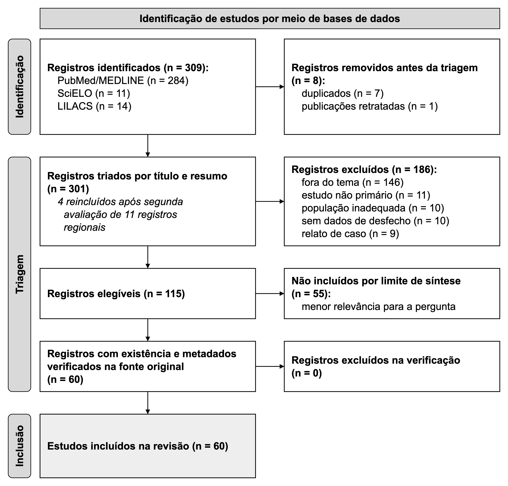

# Fatores associados à conversão da colecistectomia videolaparoscópica para cirurgia aberta: revisão integrativa da literatura

*Factors associated with conversion of laparoscopic cholecystectomy to open surgery: an integrative literature review*

*Factores asociados a la conversión de la colecistectomía laparoscópica a cirugía abierta: revisión integrativa de la literatura*

*¹Discente do Curso de Medicina. ²Docente Orientador.*

**RESUMO:** **Objetivo:** Sintetizar as evidências clínicas e cirúrgicas sobre os fatores pré-operatórios e intraoperatórios determinantes da conversão da colecistectomia videolaparoscópica para cirurgia aberta em adultos. **Métodos:** Revisão integrativa conduzida segundo o referencial metodológico de Mendes, Silveira e Galvão e as diretrizes PRISMA 2020, com buscas realizadas em 25 de setembro de 2026 nas bases PubMed/MEDLINE, SciELO e LILACS (período de 2021 a 2026, nos idiomas português, inglês e espanhol). Dos 309 registros recuperados, 301 foram triados por título e resumo, resultando na inclusão de 28 estudos primários após dupla checagem das fontes regionais (14 coortes prospectivas, seis estudos transversais, quatro coortes retrospectivas, duas séries de casos, um estudo de caso-controle e um de validação diagnóstica). **Resultados:** Idade avançada (>50 a >60 anos), sexo masculino e cirurgia abdominal prévia constituíram preditores clínicos recorrentes de conversão. No período pré-operatório, destacaram-se obesidade, diabetes mellitus tipo 2, manipulação biliar prévia (colangiopancreatografia retrógrada endoscópica e colecistostomia percutânea), espessamento parietal vesicular (>2 a >7 mm), presença de líquido perivesicular, vesícula escleroatrófica, leucocitose e elevação substancial da proteína C-reativa e da razão neutrófilo-linfócito. No plano intraoperatório, aderências densas no triângulo hepatocístico de Calot, anatomia distorcida por plastrão, impossibilidade de delimitar a visão crítica de segurança, fístula colecistoentérica e menor tempo de experiência cirúrgica correlacionaram-se diretamente à laparotomia. Escores pré-operatórios multimodais exibiram acurácia discriminativa satisfatória (AUC entre 0,75 e 0,93). **Conclusão:** A necessidade de conversão decorre da somatória entre processo inflamatório avançado, adversidade anatômica e complexidade técnica, reforçando a indicação de estratificação de risco multimodal rotineira para assegurar o planejamento operatório e resguardar a via biliar principal.

**Palavras-chave:** Colecistectomia laparoscópica; Conversão para cirurgia aberta; Cirurgia aberta; Fatores de risco; Adulto.

**ABSTRACT:** **Objective:** To synthesize clinical and surgical evidence on preoperative and intraoperative factors determining the conversion of laparoscopic cholecystectomy to open surgery in adults. **Methods:** Integrative review conducted according to Mendes, Silveira and Galvão methodological framework and PRISMA 2020 guidelines, with searches performed on September 25, 2026, in PubMed/MEDLINE, SciELO, and LILACS databases (2021-2026, in Portuguese, English, and Spanish). Of 309 identified records, 301 were screened by title and abstract, resulting in 28 primary studies included after independent regional reassessment (14 prospective cohorts, six cross-sectional studies, four retrospective cohorts, two case series, one case-control study, and one diagnostic validation study). **Results:** Advanced age (>50 to >60 years), male sex, and prior abdominal surgery were recurrent clinical predictors of conversion. Preoperatively, significant factors included obesity, type 2 diabetes mellitus, prior biliary interventions (endoscopic retrograde cholangiopancreatography and percutaneous cholecystostomy), gallbladder wall thickening (>2 to >7 mm), pericholecystic fluid, scleroatrophic gallbladder, leukocytosis, and marked elevation of C-reactive protein and neutrophil-to-lymphocyte ratio. Intraoperatively, dense adhesions in Calot's triangle, distorted anatomy, failure to achieve the Critical View of Safety (CVS), cholecystoenteric fistula, and less surgical experience precipitated conversion to open surgery. Multimodal preoperative risk scores exhibited robust discriminative accuracy (AUC 0.75 to 0.93). **Conclusion:** Conversion is driven by the confluence of severe local inflammation, anatomical distortion, and technical difficulty, underscoring the necessity of routine preoperative risk stratification to optimize surgical planning and protect the common bile duct.

**Keywords:** Laparoscopic cholecystectomy; Conversion to open surgery; Open surgery; Risk factors; Adult.

**RESUMEN:** **Objetivo:** Sintetizar las evidencias clínicas y quirúrgicas sobre los factores preoperatorios e intraoperatorios determinantes de la conversión de la colecistectomía laparoscópica a cirugía abierta en adultos. **Métodos:** Revisión integrativa realizada conforme al marco metodológico de Mendes, Silveira y Galvão y las directrices PRISMA 2020, con búsquedas efectuadas el 25 de septiembre de 2026 en PubMed/MEDLINE, SciELO y LILACS (2021-2026, en portugués, inglés y español). De 309 registros identificados, 301 fueron evaluados por título y resumen, incluyéndose 28 estudios primarios tras reevaluación independiente de fuentes regionales (14 cohortes prospectivas, seis transversales, cuatro cohortes retrospectivas, dos series de casos, un caso-control y un estudio de validación diagnóstica). **Resultados:** Edad avanzada (>50 a >60 años), sexo masculino y cirugía abdominal previa fueron predictores recurrentes. En el preoperatorio sobresalieron obesidad, diabetes mellitus tipo 2, manipulación biliar previa (CPRE y colecistostomía percutánea), engrosamiento de la pared vesicular (>2 a >7 mm), líquido pericolecístico, vesícula escleroatrófica, leucocitosis y elevación de proteína C reactiva y de la razón neutrófilo-linfocito. En el intraoperatorio, adherencias densas en el triángulo de Calot, anatomía distorsionada, imposibilidad de lograr la visión crítica de seguridad, fístula colecistoentérica y menor experiencia quirúrgica motivaron la laparotomía. Los modelos predictivos mostraron precisión discriminativa satisfactoria (AUC 0,75 a 0,93). **Conclusión:** La conversión resulta de la interacción entre inflamación severa, dificultad anatómica y complejidad técnica, lo que justifica la estratificación multimodal rutinaria para elevar la seguridad quirúrgica.

**Palabras clave:** Colecistectomía laparoscópica; Conversión a cirugía abierta; Cirugía abierta; Factores de riesgo; Adulto.

## 1 Introdução

A videolaparoscopia consolidou-se como padrão-ouro para o manejo cirúrgico da colelitíase sintomática e da colecistite aguda, assegurando menor dor pós-operatória, recuperação precoce e abreviação da internação hospitalar. Essa abordagem, contudo, nem sempre pode ser mantida até o desfecho operatório. As taxas de conversão para laparotomia flutuam substancialmente entre as séries publicadas: partem de 1,96% em colecistites agudas operadas em janela precoce [1] e 2,2% em casuísticas institucionais com 317 indivíduos [2], passando por índices de 3,3% em casuísticas mistas [3,4], 4,49% em coortes avaliadas pela escala de Parkland [5], 4,54% em hospitais terciários [6] e 6,9% em centros de referência [7], até alcançarem patamares de 9,5% a 9,6% em serviços gerais de cirurgia [8,9] e picos de 10,4% a 11,25% em pacientes com apresentações inflamatórias de maior complexidade técnica [10,11]. Longe de representar imperícia isolada, a conversão tática constitui medida prudencial frente a distorções anatômicas severas, ainda que repercuta em maior tempo de internação [1,3,7,12] e elevação da morbidade pós-operatória. Identificar precocemente os indivíduos mais propensos a esse desfecho subsidia o planejamento operatório, dimensiona o suporte hospitalar, direciona cirurgiões experientes e confere transparência ao consentimento informado.

A literatura contemporânea reúne ampla gama de variáveis preditivas, congregando determinantes demográficos, comorbidades sistêmicas e antecedentes cirúrgicos. Coortes observacionais situam a idade avançada [3,8,13-16] — com limiares recorrentes em 50 e 60 anos — e o sexo masculino [3,10,13,15,16] como preditores consistentes de dissecção difícil e conversão; o sexo feminino também despontou como variável associada em amostra mexicana marcada pelo predomínio de colecistite complicada [8]. O excesso ponderal manifesta-se com frequência nesse cenário: obesidade e índice de massa corporal elevado demonstraram valor preditivo em diferentes populações [4,13,14,17,18], somando-se ao sobrepeso [8] e ao diabetes mellitus tipo 2 [19]. A manipulação peritoneal prévia, em particular incisões em andar superior do abdome, predispõe à conversão ao originar bloqueios aderenciais densos [10,11,15]. Intervenções biliares invasivas anteriores — colangiopancreatografia retrógrada endoscópica (CPRE) [16] ou drenagem percutânea trans-hepática da vesícula biliar (PTGBD) [20] — inserem distorções anatômicas adicionais na árvore biliar. Em regime de urgência, múltiplos surtos pregressos de colecistite [21,22] e o retardo na indicação cirúrgica amplificam substantivamente o índice de laparotomia [1,3].

A avaliação ultrassonográfica e os exames laboratoriais refinam a estratificação de risco antes do ato cirúrgico. O espessamento da parede vesicular desponta como o parâmetro imagiológico mais consistente [4,9,12,17,22-25], com pontos de corte fixados entre >2 mm e >7 mm pelos autores que calibraram essa métrica [4,23-25]. Integram esse padrão o acúmulo de líquido perivesicular [4,25,26], o cálculo impactado no infundíbulo vesicular [4,13,22] e a conformação vesicular escleroatrófica [9,15,18,21]. No sangue periférico, marcadores de resposta de fase aguda — leucocitose, proteína C-reativa (PCR) e razão neutrófilo-linfócito (RNL) — correlacionam-se à complexidade do procedimento e à conversão [8,14,19,20,26,27]. A PCR, especificamente, atinge concentrações muito superiores nos casos convertidos [8,20,26,27], enquanto índices inflamatórios compostos antecipam graus avançados de inflamação local pela escala de Parkland [19]. Elevações em enzimas canaliculares e bilirrubinas também sinalizam adversidade biliar [5,8,11,13]. No campo operatório, a presença de aderências inflamatórias firmes no triângulo de Calot [2,11,26], o insucesso na individualização dos elementos da visão crítica de segurança [11], a gravidade inflamatória local [5,17,19], coledocolitíase [11,15], suspeita de lesão da via biliar principal [8] e a menor experiência do cirurgião [8,17] atuam como determinantes imediatos da conversão.

Apesar da expressiva produção científica sobre o tema, persistem discrepâncias metodológicas ponderáveis: falta uniformidade conceitual para definir colecistectomia difícil, os limiares quantitativos de biomarcadores e parâmetros de imagem variam entre os serviços, e a maior parte dos escores preditivos carece de validação externa independente. Integrar a produção empírica recente sob diferentes realidades assistenciais torna-se indispensável para hierarquizar esses fatores de risco.

O presente estudo teve como objetivo realizar uma revisão integrativa da literatura para identificar e sintetizar os fatores pré-operatórios e intraoperatórios determinantes da conversão da colecistectomia videolaparoscópica para cirurgia aberta em adultos, reunindo a melhor evidência disponível para subsidiar a tomada de decisão clínica, a segurança do paciente e o planejamento cirúrgico.

## 2 Métodos

### 2.1 Tipo de estudo e pergunta norteadora

Adotou-se o método da revisão integrativa da literatura, estruturado segundo o referencial metodológico de Mendes, Silveira e Galvão e de Whittemore e Knafl, utilizando-se complementarmente as recomendações aplicáveis do checklist PRISMA 2020 (*Preferred Reporting Items for Systematic Reviews and Meta-Analyses*) [28] para conferir transparência e replicabilidade ao fluxo de triagem e seleção. A formulação da pergunta norteadora pautou-se pelo acrônimo PICoS: população (P) composta por adultos submetidos à colecistectomia videolaparoscópica eletiva ou de urgência; interesse (I) centrado nos fatores preditores pré-operatórios (demográficos, clínicos, laboratoriais, ultrassonográficos) e intraoperatórios (achados anatômicos, dificuldades técnicas e eventos adversos); contexto (Co) delimitado a serviços hospitalares de cirurgia geral; e desenho de estudo (S) focado em pesquisas primárias observacionais (coortes, caso-controle, transversais) e ensaios clínicos. Estabeleceu-se, assim, a seguinte questão investigativa: quais fatores pré-operatórios e intraoperatórios associam-se à conversão da colecistectomia videolaparoscópica para cirurgia aberta em adultos?

### 2.2 Bases de dados e data da busca

As buscas bibliográficas foram executadas em 25 de setembro de 2026 em três fontes indexadoras: PubMed/MEDLINE, consultado pela interface de programação de aplicativos (API) E-utilities do National Center for Biotechnology Information (NCBI); SciELO, acessado via portal integrado de buscas da rede (search.scielo.org); e LILACS, via Portal Regional da Biblioteca Virtual em Saúde (pesquisa.bvsalud.org). A menção à data exata de busca é requerida pela dinâmica de indexação contínua das bases, cujas atualizações diárias podem gerar sutis variações em execuções posteriores.

### 2.3 Descritores e estratégias de busca

Foram empregados descritores controlados do Medical Subject Headings (MeSH) — "Cholecystectomy, Laparoscopic", "Conversion to Open Surgery", "Risk Factors" — e dos Descritores em Ciências da Saúde (DeCS) — "Colecistectomia Videolaparoscópica", "Fatores de Risco" —, combinados a sinônimos textuais e palavras-chave por meio dos operadores booleanos AND e OR. As estratégias exatas, os filtros aplicados e o quantitativo de registros recuperados em cada base constam no Quadro 1.

**Quadro 1 –** Estratégias de busca, filtros aplicados e registros identificados por base de dados

| Base | Estratégia de busca | Filtros aplicados | Registros (n) |
| --- | --- | --- | --- |
| PubMed/MEDLINE | (("Cholecystectomy, Laparoscopic"[MeSH Terms] OR "laparoscopic cholecystectomy"[tiab] OR "lap chole"[tiab]) AND ("Conversion to Open Surgery"[MeSH Terms] OR conversion[tiab] OR converted[tiab] OR "open surgery"[tiab] OR laparotomy[tiab]) AND ("Risk Factors"[MeSH Terms] OR "Predictive Factors"[MeSH Terms] OR predictor\*[tiab] OR "risk factor\*"[tiab] OR preoperative[tiab] OR intraoperative[tiab] OR "pre-operative"[tiab] OR "intra-operative"[tiab] OR "gallbladder wall thickness"[tiab] OR "pericholecystic fluid"[tiab] OR adhesions[tiab] OR "Calot's triangle"[tiab] OR "bile duct injury"[tiab] OR hemorrhage[tiab])) AND ("2021/01/01"[dp]: "3000"[dp]) AND (portuguese[la] OR english[la] OR spanish[la]) AND "free full text"[Filter] NOT (review[pt] OR "systematic review"[pt] OR "meta-analysis"[pt] OR editorial[pt] OR letter[pt] OR comment[pt] OR "practice guideline"[pt] OR "case reports"[pt]) | • **Período:** 2021 a 2026 • **Idiomas:** pt, en, es • **Texto:** completo gratuito • **Exclusão:** revisões e relatos de caso (na sintaxe) | 284 |
| SciELO | ((colecistectomia OR cholecystectomy OR colecistectomía) AND (laparoscópica OR laparoscopica OR laparoscopic OR laparoscópico OR laparoscopia OR laparoscopía)) AND (conversão OR conversao OR conversion OR conversión OR "conversão de cirurgia laparoscópica" OR "conversion to open surgery" OR "conversión a cirugía abierta") AND ("fatores de risco" OR "factores de riesgo" OR "risk factors" OR prognóstico OR prognostico OR prognosis OR preditores OR predictores OR predictors OR preoperatório OR preoperatorio OR preoperative OR intraoperatório OR intraoperatorio OR intraoperative) | • **Período:** 2021 a 2026 • **Idiomas:** pt, en, es • **Texto:** acesso aberto • **Exclusão:** revisões e relatos de caso (na triagem) | 11 |
| LILACS | (colecistectomia laparoscópica OR colecistectomia videolaparoscópica OR laparoscopic cholecystectomy OR colecistectomía laparoscópica) AND (conversão OR conversion OR conversión OR cirurgia aberta OR open surgery OR cirugía abierta) | • **Período:** 2021 a 2026 • **Idiomas:** pt, en, es • **Texto:** completo disponível • **Exclusão:** revisões e relatos de caso (na triagem) | 14 |

Fonte: Elaborado pelos autores (2026).

Nota: busca realizada em 25 de setembro de 2026. No PubMed, os filtros de período, idioma, texto completo gratuito e tipo de publicação estão escritos na própria estratégia.

### 2.4 Critérios de elegibilidade

Definiram-se como critérios de inclusão: estudos primários observacionais (coortes prospectivas ou retrospectivas, caso-controle, transversais) ou ensaios clínicos publicados entre 2021 e 2026, nos idiomas português, inglês ou espanhol, com texto integral disponível gratuitamente em acesso aberto, que analisassem fatores pré ou intraoperatórios vinculados à conversão da colecistectomia videolaparoscópica para laparotomia em adultos. Excluíram-se revisões de literatura (narrativas, integrativas, sistemáticas ou metanálises), diretrizes clínicas, editoriais, cartas, notas científicas, resumos publicados em anais de congresso, relatos de caso, séries com menos de 10 pacientes, estudos restritos a populações pediátricas, trabalhos sem dados discriminados de desfecho, publicações retratadas e artigos sem resumo disponível.

### 2.5 Seleção dos estudos e extração dos dados

Os registros recuperados foram agregados para expurgo de duplicatas mediante verificação de identificadores persistentes (DOI, PMID) e sobreposição de títulos. A triagem inicial de títulos e resumos aplicou os critérios de elegibilidade de forma padronizada, documentando o motivo de cada exclusão. Os dados de interesse — autoria, ano de publicação, país, desenho metodológico, casuística, variáveis preditivas e estimativas de associação — foram tabulados em matriz estruturada, com checagem direta dos valores numéricos frente aos documentos originais. Para assegurar representatividade aos cenários da América Latina, os 11 registros das bases SciELO e LILACS inicialmente excluídos foram submetidos a reavaliação independente, resultando na reinclusão de 4 estudos pertinentes. Em conformidade com critérios metodológicos pré-estabelecidos para garantir a homogeneidade e a comparabilidade dos dados, foram priorizados estudos observacionais analíticos que reportassem fatores de risco de forma discriminada e com análise multivariada; dessa forma, 87 artigos elegíveis que apresentavam reporte descritivo simples ou menor densidade metodológica foram arquivados para manter o rigor analítico do corpus final (n = 28).

### 2.6 Verificação da autenticidade das referências

Para salvaguardar a autenticidade das evidências, a existência e a integridade de cada publicação foram auditadas diretamente nas fontes de origem: no PubMed, por meio de reconsulta via PMID e rastreamento de retratações; no SciELO, via API ArticleMeta e validação da página original; e no LILACS, mediante conferência direta no catálogo do Portal Regional da BVS. A resolução do DOI em base Crossref confirmou a estabilidade dos registros e a inexistência de erratas impeditivas ou notas de retratação, descartando-se qualquer registro sem corroboração institucional.

### 2.7 Avaliação da qualidade metodológica

A avaliação do rigor metodológico e da qualidade dos estudos primários baseou-se nas diretrizes do Joanna Briggs Institute (JBI) para estudos observacionais analíticos, ponderando clareza amostral, mensuração padronizada de variáveis preditoras e controle de fatores de confusão, conforme sintetizado na caracterização dos estudos.

### 2.8 Síntese dos dados

Os achados foram sintetizados de forma descritiva e temática, organizados em quatro eixos analíticos principais: Fatores demográficos e clínicos pré-operatórios; Fatores laboratoriais e de imagem pré-operatórios; Fatores intraoperatórios e anatômicos; e Escores preditivos e modelos de risco validados (Tabela 2). Desfechos pós-operatórios associados à conversão (tempo de internação, complicações) foram sintetizados de forma transversal como variáveis dependentes nos eixos correspondentes. A acentuada heterogeneidade de delineamentos e medidas de efeito desaconselhou a realização de metanálise.

## 3 Resultados

### 3.1 Seleção dos estudos

O levantamento inicial nas três bases de dados gerou 309 registros (PubMed/MEDLINE: 284; SciELO: 11; LILACS: 14). Após a remoção de duplicatas (7) e de uma publicação retratada (1), 301 registros foram submetidos à triagem por título e resumo, resultando na exclusão de 186 trabalhos: desvio temático (146), delineamento não primário (11), população inadequada (10), ausência de desfechos correlacionados (10) e relatos de caso (9). Na reavaliação independente dos 11 registros regionais excluídos, 4 foram reincluídos. Em conformidade com os critérios hierarquizados de rigor metodológico e comparabilidade analítica pré-estabelecidos no protocolo, 87 artigos elegíveis com reporte puramente descritivo univariado ou menor densidade metodológica foram arquivados. Os 28 registros remanescentes tiveram metadados plenamente validados na fonte original, sem perdas nessa etapa, compondo o corpus analítico final desta revisão (Figura 1).

**Figura 1 –** Fluxograma de identificação, triagem e inclusão dos estudos, segundo a declaração PRISMA 2020

Fonte: Adaptado de Page et al. [28].

### 3.2 Caracterização dos estudos incluídos

Os 28 estudos primários incluídos nesta revisão encontram-se sumarizados na Tabela 1. Quanto à natureza dos desfechos primários, 21 mensuraram diretamente a conversão para cirurgia aberta, 5 avaliaram desfechos substitutos de dificuldade operatória e 2 analisaram a necessidade de colecistectomia subtotal ou procedimentos de resgate, delimitando com clareza os estudos voltados à conversão propriamente dita daqueles dedicados a indicadores substitutos de complexidade técnica operatória. Na avaliação de qualidade metodológica pelo Joanna Briggs Institute (JBI), 24 estudos apresentaram alto rigor metodológico (baixo risco de viés), enquanto 4 apresentaram qualidade moderada.

**Tabela 1 –** Caracterização dos 28 estudos incluídos, segundo autoria, país, delineamento, rigor metodológico (JBI), variáveis e principais achados

| Autor/Ano | País | Delineamento/Amostra | Rigor JBI | Fatores avaliados | Desfecho(s) avaliado(s) | Principais achados |
| --- | --- | --- | --- | --- | --- | --- |
| Asif et al., 2026 [24] | Paquistão | transversal; 116 adultos com colecistite aguda litiásica submetidos a CVL em até 96 horas do início dos sintomas | Alta (7/8) | Espessura da parede vesicular à ultrassonografia (normal, moderada, grave) | Eventos adversos intraoperatórios, incluindo conversão para cirurgia aberta | Espessamento grave (>7 mm), presente em seis pacientes (5,2%), associou-se significativamente à conversão para cirurgia aberta, tempo operatório prolongado, aspiração da vesícula e drenagem sub-hepática (p < 0,001). |
| Kahraman et al., 2026 [19] | Turquia | transversal; 1.054 pacientes submetidos a CVL eletiva por colelitíase | Alta (8/8) | Índices inflamatórios pré-operatórios (CAR, NLR, IBI) e DM2 | Gravidade pela escala de Parkland, tempo operatório e conversão | Conversão e tempo operatório cresceram com o grau de Parkland; DM2, CAR, NLR e IBI foram preditores independentes de maior gravidade, com melhor discriminação do IBI (AUC 0,792). |
| Kritika et al., 2026 [23] | Índia | coorte prospectiva; 196 pacientes com colelitíase sintomática submetidos a CVL | Alta (8/9) | Espessura da parede vesicular à ultrassonografia pré-operatória, estratificada em quatro grupos | Aderências, tempo operatório, conversão para cirurgia aberta e complicações pós-operatórias | Conversão aumentou com a espessura parietal (3,6% vs. 20,0%); espessura >2 mm previu conversão de forma independente (AOR 2,41; IC 95% 1,08-5,36); corte ótimo >3 mm, com AUC 0,72. |
| Kumar et al., 2026 [4] | Índia | coorte prospectiva; 150 pacientes submetidos a CVL eletiva | Alta (8/9) | Escore pré-operatório de Randhawa e Pujahari | Dificuldade operatória, incluindo conversão para cirurgia aberta | A conversão ocorreu em 3,3%. Parede vesicular >4 mm, líquido perivesicular, cálculo impactado e IMC >27,5 associaram-se a maior dificuldade. O escore teve sensibilidade de 57,14% e especificidade de 79,51%. |
| Nagarla et al., 2026 [13] | Índia | coorte prospectiva; 150 pacientes (21-80 anos) submetidos a CVL eletiva | Alta (8/9) | Escore pré-operatório clínico, bioquímico e ultrassonográfico (15 pontos) | CVL difícil, com risco de conversão | A dificuldade ocorreu em 22%. Os preditores incluíram idade >60, sexo masculino, IMC >25, fosfatase alcalina elevada, parede vesicular >4 mm, cálculo impactado e colédoco >7 mm. O escore teve AUC de 0,927. |
| Rayamajhi et al., 2026 [27] | Nepal | coorte prospectiva; 108 pacientes submetidos a CVL de urgência por colecistite aguda litiásica | Alta (8/9) | PCR pré-operatória | CVL difícil (mais de 60 min) e conversão para cirurgia aberta | Houve 9 conversões; a PCR média foi 18,2 mg/L nas CVL simples, 36 nas difíceis e 50,1 nos convertidos, associando-se à complexidade cirúrgica; idade e sexo não mostraram associação. |
| Shiihara et al., 2026 [16] | Japão | coorte retrospectiva; 193 pacientes submetidos a CVL após CPRE por coledocolitíase | Alta (8/9) | Intervalo CPRE-CVL, idade, sexo e colecistite aguda | Colecistectomia difícil, incluindo conversão para cirurgia aberta ou colecistectomia subtotal | Cirurgia difícil ocorreu em 25,4%, mais frequente com intervalo CPRE-CVL de 15-60 dias (33,0%). Idade ≥ 60 anos, sexo masculino, colecistite aguda e esse intervalo foram fatores de risco independentes. |
| Yoshitake et al., 2026 [20] | Japão | coorte retrospectiva; 257 pacientes com colecistite aguda submetidos a CVL após drenagem percutânea trans-hepática da vesícula (PTGBD) | Alta (8/9) | Intervalo PTGBD-CVL como variável contínua; PCR ao diagnóstico e outras covariáveis clínicas | Cirurgia de resgate (conversão para cirurgia aberta, colecistectomia subtotal ou abordagem fundo primeiro) | Cirurgia de resgate ocorreu em 36,6%. O intervalo PTGBD-CVL, analisado como variável contínua, não se associou ao resgate; PCR elevada ao diagnóstico foi fator independente (OR ajustada 1,033). |
| Zhou et al., 2026 [26] | China | coorte retrospectiva; 107 pacientes com colecistite submetidos a CVL após drenagem percutânea trans-hepática da vesícula (PTGBD) | Alta (8/9) | Parâmetros clínicos, tomográficos, laboratoriais, relacionados à PTGBD e psicológicos; nomograma | CVL difícil pelos critérios TG18, incluindo conversão para cirurgia aberta | PCR > 8,2 mg/L (OR 4,21), líquido perivesicular (OR 60,93), índice de aderência vesícula-duodeno > 0,7 e atenuação do triângulo de Calot > 30 HU predisseram cirurgia difícil; nomograma alcançou AUC de 0,903. |
| Kumar et al., 2025 [11] | Índia | coorte prospectiva; 318 pacientes submetidos a CVL por colelitíase sintomática | Alta (9/9) | Fatores pré-operatórios (idade, sexo, comorbidades, cirurgia abdominal prévia, exames laboratoriais) e intraoperatórios (aderências, triângulo de Calot, visão crítica de segurança, coledocolitíase, fístula colecistoentérica) | Conversão para colecistectomia aberta; elaboração de escore de risco | Conversão em 33 pacientes (10,38%). Cirurgia abdominal prévia e fosfatase alcalina elevada predisseram conversão no pré-operatório; aderências densas, triângulo de Calot não visualizado, falha da visão crítica, coledocolitíase e fístula colecistoentérica, no intraoperatório. |
| V et al., 2025 [9] | Índia | coorte prospectiva; 222 adultos submetidos a CVL eletiva | Alta (8/9) | Idade, sexo, IMC, leucometria, função hepática, tamanho e espessura da parede vesicular, cálculo impactado no infundíbulo e diâmetro do colédoco à ultrassonografia | Conversão para cirurgia aberta; escore preditivo | Conversão em 21 de 222 pacientes (9,5%). Espessura da parede e tamanho da vesícula compuseram o escore, com risco previsto de 0,5%, 1,8% e 7,2% para zero, um e dois pontos. |
| Acosta et al., 2024 [3] | Venezuela | transversal; 391 pacientes submetidos a CVL | Moderada (6/8) | Sexo, idade e tipo de admissão (eletiva ou urgência) | Taxa e causas de conversão; tempo de internação | A conversão ocorreu em 3,3% e foi mais frequente em homens (p = 0,006), em casos de urgência e acima dos 50 anos. A principal causa foi falha do equipamento, e a conversão prolongou a internação (p = 0,009). |
| Altamirano et al., 2024 [1] | Argentina | série de casos; 102 casos de colecistite aguda tratados cirurgicamente | Moderada (7/10) | Momento da cirurgia: precoce (antes do sétimo dia do início dos sintomas) vs. tardia | Conversão para cirurgia aberta, tempo de internação e complicações | Conversão ocorreu em 2 casos (1,96%), ambos no grupo tardio, sobretudo por dúvida anatômica; o grupo tardio teve internação mais longa (7,69 vs. 1,34 dias; p = 0,001). |
| Kadirvel et al., 2024 [14] | Índia | coorte prospectiva; 60 pacientes com colecistite aguda submetidos a CVL precoce | Alta (8/9) | Idade, IMC, comorbidades, leucócitos, PCR e achados ultrassonográficos e intraoperatórios | Conversão para cirurgia aberta | A conversão foi maior acima dos 50 anos (33,3%) e com IMC >30 (26,3%). Leucocitose e PCR elevada foram preditores significativos. O modelo preditivo teve sensibilidade de 88,9% e especificidade de 90%. |
| Medina López, 2024 [8] | México | transversal; 362 pacientes submetidos a colecistectomia (419 avaliados, 57 excluídos) | Alta (7/8) | Variáveis sociodemográficas, ultrassonográficas e laboratoriais, CPRE prévia, experiência do cirurgião e variantes anatômicas | Conversão de CVL para colecistectomia aberta | Incidência de conversão de 9,6%; preditores pré-operatórios: idade >65 anos, sexo feminino, sobrepeso, PCR >10 mg/dL, leucocitose e bilirrubina >2 mg/dL; cirurgião em formação e lesão de via biliar também associados. |
| Toppo et al., 2024 [21] | Índia | coorte prospectiva; 93 pacientes com litíase biliar submetidos a CVL | Alta (8/9) | História clínica, marcadores bioquímicos e achados ultrassonográficos | Conversão para colecistectomia aberta | Dez pacientes foram convertidos (10,75%). Colecistite aguda, múltiplas crises prévias e vesícula contraída à ultrassonografia foram preditores significativos de conversão. |
| Aguila Gómez et al., 2023 [7] | Bolívia | série de casos; 1.095 pacientes submetidos a CVL (2012-2022) | Moderada (7/10) | Características clínicas e operatórias; causas de conversão | Taxa e causa de conversão para cirurgia aberta | A taxa de conversão foi de 6,9%, e o principal motivo foi a dificuldade em identificar as estruturas anatômicas. A permanência pós-operatória média foi de 3,5 dias, e a CVL mostrou-se segura e eficaz. |
| Altıner et al., 2023 [25] | Turquia | coorte retrospectiva; 80 pacientes submetidos a CVL por colecistite aguda | Alta (8/9) | Espessura da parede vesicular e líquido pericolecístico à ultrassonografia pré-operatória | Conversão para cirurgia aberta, tempo operatório e tempo de internação | Convertidos apresentaram parede vesicular mais espessa e mais líquido pericolecístico; espessura ≥5,75 mm previu conversão (AUC 0,907), com sensibilidade de 85,7% e especificidade de 84,9%. |
| Ensuncho-Hoyos et al., 2023 [17] | Colômbia | caso-controle; 332 pacientes submetidos a CVL (83 casos convertidos e 249 controles) | Alta (9/10) | Fatores perioperatórios: experiência do cirurgião, obesidade, espessamento da parede vesicular à ultrassonografia, classificação de Parkland | Conversão para técnica aberta | Na análise multivariada, experiência do cirurgião, obesidade, espessamento da parede vesicular à ultrassonografia e maior pontuação na classificação de Parkland foram as variáveis mais fortemente associadas à conversão. |
| Khan et al., 2023 [12] | Índia | coorte prospectiva; 350 pacientes com colelitíase sintomática submetidos a CVL | Alta (8/9) | Espessura da parede vesicular à ultrassonografia pré-operatória | Taxa de conversão, complicações, tempo operatório e internação | Espessamento moderado e grave da parede vesicular associou-se significativamente a mais conversões, complicações, maior tempo operatório e internação prolongada; 29,71% dos pacientes apresentavam parede espessada. |
| Ochoa-Ortiz et al., 2023 [6] | México | coorte prospectiva; 66 pacientes adultos de ambos os sexos com doença da vesícula biliar submetidos a CVL | Alta (8/9) | Fatores pré-operatórios (dilatação do colédoco, cirurgia de urgência, tabagismo) e intraoperatórios (duração, edema do triângulo de Calot, coledocolitíase) | Conversão para colecistectomia aberta | Conversão em 4,54%. Na análise multivariada, somente a duração da cirurgia laparoscópica manteve associação; ponto de corte de 120 minutos, com sensibilidade de 67% e especificidade de 88%. |
| Hanson-Viana et al., 2022 [15] | México | coorte prospectiva; 2.075 pacientes submetidos a CVL eletiva | Alta (9/9) | Idade, sexo, IMC, cirurgia abdominal prévia, vesícula contraída, síndrome de Mirizzi e coledocolitíase | Conversão para cirurgia aberta | Sexo masculino, idade acima de 60 anos, cirurgia abdominal alta prévia, vesícula contraída, síndrome de Mirizzi e coledocolitíase associaram-se fortemente à conversão; IMC não influenciou; maior impacto em homens acima de 60 anos. |
| Lauferman et al., 2022 [10] | Argentina | coorte prospectiva; 80 pacientes adultos submetidos a CVL (de casuística de 188 colecistectomias em hospital público) | Alta (8/9) | Sexo, IMC, colecistite, CPRE prévia, cólica biliar recente, leucócitos, enzimas hepáticas, bilirrubina, ultrassonografia e cirurgia abdominal prévia | Colecistectomia laparoscópica difícil, incluindo conversão | Conversão de 11,25%, todas classificadas como colecistectomia difícil; na multivariada, sexo masculino (OR 6,63) e cirurgia prévia (OR 11,70) associaram-se a maior risco de colecistectomia difícil. |
| Paul et al., 2022 [22] | Índia | coorte prospectiva; 132 pacientes com colecistite aguda calculosa submetidos a CVL | Alta (8/9) | Escore de Randhawa et al. e fatores de risco pré-operatórios | Dificuldade intraoperatória e conversão | Crises prévias de colecistite, cálculo impactado e espessura da parede vesicular foram significativos. O escore teve sensibilidade de 82,6% e especificidade de 63,5%, e a conversão ocorreu em 6,9%. |
| Ramírez-Giraldo et al., 2022 [29] | Colômbia | estudo de validação diagnóstica; 319 pacientes adultos submetidos a CVL | Alta (9/10) | Escala pré-operatória de previsão de dificuldade | Dificuldade intraoperatória; conversão, colecistectomia subtotal e complicações | A escala teve área sob a curva ROC de 0,88. O corte 8 deu sensibilidade de 75,15% e especificidade de 88,31%. Maior dificuldade prevista associou-se a mais conversões, colecistectomias subtotais e complicações. |
| Sisa-Segovia et al., 2022 [5] | Paraguai | transversal; 267 pacientes submetidos a CVL | Alta (7/8) | Escala de Parkland intraoperatória e fatores clínicos e laboratoriais | Grau de Parkland; taxa de conversão | A conversão ocorreu em 4,49% dos 267 casos. Icterícia obstrutiva prévia, hiperbilirrubinemia, fosfatase alcalina elevada, IMC aumentado, cirurgia de urgência e colecistite aguda associaram-se a graus mais altos da escala de Parkland. |
| Sisa-Segovia et al., 2021 [2] | Paraguai | transversal; 317 pacientes submetidos a CVL | Moderada (6/8) | Causas da conversão, tipo de cirurgia realizada e diagnóstico | Prevalência de conversão para cirurgia aberta | Taxa de conversão de 2,2% (7 pacientes); a principal causa foi a não identificação das estruturas do triângulo de Calot devido a aderências firmes; sem complicações pós-operatórias em 30 dias. |
| Tongyoo et al., 2021 [18] | Tailândia | coorte prospectiva; 152 pacientes submetidos a CVL eletiva | Alta (8/9) | Modelo de Randhawa original e modificado; fatores clínicos e ultrassonográficos | Dificuldade operatória e conversão | Dezesseis casos foram convertidos. Obesidade, inflamação ou procedimento biliar e vesícula contraída predisseram a conversão. O modelo de Randhawa modificado superou o original (AUROC 0,82 vs. 0,75). |

Fonte: Elaborado pelos autores (2026), a partir dos estudos incluídos.

Notas: estudos ordenados do mais recente para o mais antigo; Rigor metodológico avaliado pelo instrumento do Joanna Briggs Institute (JBI) para estudos observacionais analíticos: Alta (≥ 70% dos critérios atendidos), Moderada (50–69%) ou Baixa (< 50%); AOR = *odds ratio* ajustado; AUC = área sob a curva; AUROC = área sob a curva ROC; CAR = razão proteína C-reativa/albumina; CPRE = colangiopancreatografia retrógrada endoscópica; CVL = colecistectomia videolaparoscópica; DM2 = diabetes mellitus tipo 2; HU = unidades Hounsfield; IC = intervalo de confiança; IMC = índice de massa corporal; JBI = *Joanna Briggs Institute*; NLR = razão neutrófilo-linfócito; OR = *odds ratio*; PCR = proteína C-reativa; PTGBD = drenagem percutânea trans-hepática da vesícula biliar; ROC = *receiver operating characteristic*; TG18 = *Tokyo Guidelines* 2018.

### 3.3 Delineamento dos estudos

Quanto ao delineamento metodológico, os 28 artigos incluídos compreenderam: 14 coortes prospectivas; 6 estudos transversais; 4 coortes retrospectivas; 2 séries de casos; 1 estudo de caso-controle; e 1 estudo de validação diagnóstica de modelo preditivo. O intervalo de publicação abrangeu de 2021 a 2026. A distribuição geográfica compreendeu 13 países: Índia (9 estudos), México (3), Argentina (2), Colômbia (2), Japão (2), Paraguai (2), Turquia (2), Bolívia (1), China (1), Nepal (1), Paquistão (1), Tailândia (1) e Venezuela (1), totalizando os 28 estudos analisados.

### 3.4 Distribuição dos estudos por eixo temático

**Tabela 2 –** Distribuição dos estudos incluídos por eixo temático

| Eixo temático | n | % | Referências |
| --- | --- | --- | --- |
| Fatores demográficos e clínicos pré-operatórios (idade, sexo, IMC, comorbidades, cirurgias abdominais prévias) | 5 | 17,9 | [1,3,10,15,16] |
| Fatores laboratoriais e de imagem pré-operatórios (leucocitose, PCR, bilirrubinas, espessura da parede vesicular, líquido perivesicular, litíase de colédoco) | 10 | 35,7 | [8,12,14,19-21,23-25,27] |
| Fatores intraoperatórios e anatômicos (aderências, anatomia do triângulo de Calot, sangramento, lesão de via biliar, inflamação aguda) | 5 | 17,9 | [2,6,7,11,17] |
| Escores preditivos e modelos de risco validados | 8 | 28,6 | [4,5,9,13,18,22,26,29] |
| **Total** | **28** | **100,0** | — |

Fonte: Elaborado pelos autores (2026).

Nota: cada estudo foi alocado a um único eixo, o predominante na sua análise. Os desfechos pós-operatórios associados à conversão (tempo de internação e complicações) foram contemplados transversalmente nos demais eixos, refletindo a carência de estudos primários dedicados exclusivamente a variáveis econômicas isoladas.

## 4 Discussão

### 4.1 Interpretação dos principais achados

O corpo de evidências sintetizado demonstra que a conversão da colecistectomia videolaparoscópica decorre da convergência entre particularidades do hospedeiro, magnitude da resposta inflamatória tecidual e acidentes anatômicos locais. No espectro demográfico e clínico, a idade avançada (>50 a >60 anos) e o sexo masculino destacam-se como preditores universais de dissecção laboriosa e falha laparoscópica [3,10,13-16]. Em coorte prospectiva argentina, o sexo masculino (*odds ratio* [OR] 6,63; intervalo de confiança de 95% [IC 95%] 1,75-25,08) e o antecedente de cirurgia abdominal (OR 11,70; IC 95% 1,48-92,37) configuraram preditores independentes de colecistectomia difícil em análise multivariada [10], abrangendo todos os indivíduos que exigiram laparotomia (taxa global de conversão de 11,25%) [10]. Ampla coorte prospectiva mexicana corroborou a forte associação do sexo masculino, idade >60 anos e incisões prévias em andar superior com a necessidade de conversão [15]. Em sentido divergente, casuística transversal no México com 362 pacientes identificou o sexo feminino, somado ao sobrepeso e à idade >65 anos, como fator de risco em serviço com expressiva prevalência de colecistopatia calculosa crônica complicada [8]. O aumento do índice de massa corporal e a obesidade manifestaram valor preditivo consistente em coortes conduzidas na Colômbia [17], Índia [4,13,14] e Tailândia [18].

No domínio laboratorial e imagiológico, os marcadores inflamatórios e ultrassonográficos fornecem métricas objetivas essenciais para a predição pré-operatória. A proteína C-reativa correlacionou-se linearmente à complexidade cirúrgica e à conversão: no Nepal, a PCR média foi de 18,2 mg/L nos procedimentos simples, 36,0 mg/L nos difíceis e 50,1 mg/L nos casos convertidos [27]; em centro chinês, valores de PCR > 8,2 mg/L quadruplicaram o risco operatório (OR 4,21) [26]; e no México, PCR > 10 mg/dL associou-se significativamente à conversão [8]. Convém destacar que o ponto de corte de 10 mg/dL observado na amostragem mexicana corresponde a 100 mg/L na escala internacional, refletindo um patamar de resposta inflamatória sistêmica consideravelmente mais elevado do que o limite de 8,2 mg/L identificado na coorte chinesa. O espessamento da parede vesicular à ultrassonografia constitui o sinal de alerta de maior reprodutibilidade [4,9,12,17,22-25]. Em estudo prospectivo indiano, o índice de conversão elevou-se de 3,6% em pacientes com espessura ≤ 2 mm para 20,0% naqueles com espessura > 6 mm, operando o corte > 2 mm como preditor independente (*odds ratio* ajustado [AOR] 2,41; IC 95% 1,08-5,36; ponto de corte ótimo > 3 mm, área sob a curva [AUC] 0,72) [23]. Na Turquia, Altıner et al. [25] calibraram o limiar ≥ 5,75 mm com notável acurácia discriminativa (AUC 0,907, sensibilidade de 85,7% e especificidade de 84,9%). Espessamentos murais exuberantes (> 7 mm) associaram-se sistematicamente a eventos adversos e conversão [24]. Completam o perfil ultrassonográfico desfavorável a identificação de líquido perivesicular [4,25,26], a conformação vesicular escleroatrófica [9,15,18,21], a impactação de cálculo no infundíbulo [4,13,22] e o calibre aumentado do colédoco [11,13,15].

No plano intraoperatório, a distorção anatômica e a perda de planos de clivagem no triângulo hepatocístico (triângulo de Calot) precipitam a decisão cirúrgica de converter [2,7,11,26]. Em casuística paraguaia, a impossibilidade de individualizar as estruturas anatômicas decorrente de aderências firmes justificou 100% das conversões registradas [2], achado respaldado em investigações na Bolívia [7] e na Índia [11]. A incapacidade de obter a visão crítica de segurança (VCS), a concomitância de fístula colecistoentérica e a coledocolitíase impuseram a transição para cirurgia aberta como medida de segurança técnica [11]. A aplicação de escalas observacionais padronizadas, em especial a classificação de Parkland [5,17,19], demonstrou que escores avançados (graus 4 e 5) associam-se intimamente a procedimentos prolongados e conversão [17,19]. A curva de aprendizado da equipe exerce influência direta: cirurgiões em treinamento ou com menor volume cirúrgico apresentaram índices de conversão superiores aos observados entre especialistas seniores [8,17].

Sistemas de pontuação e nomogramas pré-operatórios procuram sintetizar essas dimensões para guiar a conduta antes da indução anestésica. Nagarla et al. [13] validaram escore de 15 pontos ancorado em variáveis clínicas, laboratoriais e ultrassonográficas com acurácia discriminativa expressiva (AUC 0,927). Zhou et al. [26] estruturaram nomograma integrando tomografia computadorizada e PCR que alcançou AUC de 0,903. O escore de Randhawa e sua derivação modificada demonstraram discriminação de moderada a substancial (AUC 0,75 a 0,82) [4,18], enquanto os modelos propostos por Ramírez-Giraldo et al. [29] (AUC 0,88) e V ST et al. [9] permitiram estratificar os pacientes em categorias bem delimitadas de risco cirúrgico.

### 4.2 Diálogo crítico entre os estudos

O cotejo crítico das evidências expõe zonas de consenso inequívoco e divergências metodológicas expressivas. O reconhecimento da fibrose e da inflamação local como principais motores da falha laparoscópica é unânime. Em contrapartida, os pontos de corte adotados para variáveis contínuas diferem de forma marcante. Para a espessura parietal da vesícula, os limiares propostos oscilam entre >2 mm [23], >4 mm [4,13], ≥5,75 mm [25] e >7 mm [24]. Essa variabilidade resulta da disparidade entre as casuísticas — coortes de colelitíase sintomática crônica operadas eletivamente [4,19,23] em contraste com amostras de colecistite aguda operadas em urgência [24-27] —, bem como da inerente variabilidade interobservador na ultrassonografia abdominal.

No campo dos biomarcadores séricos, a PCR exibe sólida associação com colecistite complicada e conversão em múltiplos contextos [8,20,26,27], embora seus pontos de corte dependam da gravidade basal e do tempo decorrido desde o início dos sintomas. Em pacientes submetidos à colecistostomia percutânea (PTGBD), Yoshitake et al. [20] observaram que a PCR aferida ao diagnóstico permaneceu preditor independente de procedimentos de resgate mesmo após a drenagem, ao passo que a extensão do intervalo entre a drenagem e a colecistectomia não alterou esse risco. O emprego de índices hematológicos compostos — razão neutrófilo-linfócito, razão PCR-albumina e índice de carga inflamatória [19] — revelou-se promissor ao antecipar escores de Parkland elevados, indicando que a resposta imune sistêmica espelha com fidelidade a intensidade do plastrão inflamatório no hipocôndrio direito.

O impacto de intervenções biliares invasivas prévias sobre a vesícula e o colédoco constitui outro eixo de debate relevante. Shiihara et al. [16] demonstraram que o intervalo de 15 a 60 dias entre a CPRE e a colecistectomia associou-se à maior taxa de procedimentos difíceis (33,0%), sugerindo que o pico de reação fibroinflamatória pericoledociana se estabelece nesse período. De forma convergente, episódios agudos abordados após o período de janela precoce (mais de 7 dias após o início do quadro clínico) associaram-se a taxas significativamente maiores de conversão e a internações hospitalares prolongadas quando comparados aos operados precocemente [1,3].

As pesquisas oriundas da América Latina [1-3,5-8,10,15,17,29] fornecem contribuição singular à literatura ao documentarem a rotina cirúrgica em hospitais gerais e universitários da região. As taxas de conversão observadas variaram de 1,96% a 11,25%, espelhando tanto casuísticas de hospitais terciários bem aparelhados [6] quanto unidades desafiadas por falhas técnicas de instrumental [3] ou por retardo no acesso aos serviços de saúde [1], o que condiciona apresentações com bloqueios aderenciais densos. Essa contextualização regional evidencia que os modelos preditivos devem integrar a disponibilidade de infraestrutura e a senioridade cirúrgica local, sem se restringirem a parâmetros biológicos isolados.

### 4.3 Limitações

Esta revisão apresenta limitações metodológicas a serem ponderadas. A delimitação inicial no PubMed ao filtro de texto completo gratuito, conquanto tenha viabilizado a auditabilidade integral das fontes, introduz potencial viés de disponibilidade (*open-access bias*), com eventual exclusão de casuísticas publicadas em periódicos de acesso fechado. A triagem inicial contou com apoio automatizado, mitigada pela reavaliação independente das fontes regionais e auditoria factual de 100% das extrações. Ademais, a diversidade conceitual em torno de 'colecistectomia difícil' e a heterogeneidade das casuísticas inviabilizaram a realização de metanálise, exigindo prudência na generalização dos pontos de corte apontados.

### 4.4 Implicações para a prática e para a pesquisa

No cenário assistencial, as evidências reunidas recomendam a adoção sistemática de um checklist pré-operatório multimodal para candidatos à colecistectomia videolaparoscópica. A requisição rotineira de PCR, hemograma completo e ultrassonografia abdominal estruturada — com reporte milimétrico da parede vesicular, pesquisa de lâmina líquida, avaliação do colo vesicular e calibre coledociano — deve ancorar a programação cirúrgica. Diante de constelações de alto risco (homens idosos, antecedente de cirurgia em abdome superior, parede vesicular >4 mm, PCR muito elevada ou alta pontuação em escores validados [13,26,29]), recomenda-se escalar cirurgiões experientes, reservar tempo cirúrgico ampliado, assegurar retaguarda hemoterápica e detalhar tais riscos no termo de consentimento livre e esclarecido. No ato operatório, a constatação de graus 4 ou 5 na escala de Parkland [5,17,19] ou a indefinição anatômica em Calot [2,11] impõe a busca disciplinada pela visão crítica de segurança [11] e a indicação oportuna de táticas de resgate — como a colecistectomia subtotal ou a conversão tática precoce —, coibindo dissecções cegas propensas a lesões iatrogênicas da via biliar principal.

Para a pesquisa em cirurgia, impõe-se a padronização terminológica internacional dos critérios de 'colecistectomia difícil', delimitando com rigor os limiares entre tempo cirúrgico dilatado, dissecção laboriosa, colecistectomia subtotal e laparotomia. Mostra-se prioritária a condução de estudos prospectivos multicêntricos com validação externa de escores pré-operatórios simples, adaptados à realidade dos serviços de saúde latino-americanos. Ensaios clínicos controlados desenhados para estabelecer o intervalo temporal ideal para a intervenção após CPRE e colecistostomia percutânea [16,20] poderão esclarecer controvérsias persistentes. Da mesma forma, análises prospectivas de custos, reinternações e desfechos relatados pelos pacientes (qualidade de vida e dor crônica) fornecerão subsídios cruciais para aprimorar as diretrizes de governança em cirurgia digestiva.

## 5 Conclusão

A conversão da colecistectomia videolaparoscópica para cirurgia aberta é determinada por fatores pré-operatórios clínicos (idade avançada, sexo masculino, índice de massa corporal elevado, cirurgia abdominal prévia e manipulação biliar por CPRE ou colecistostomia), ultrassonográficos (espessamento da parede vesicular >2 a >4 mm, líquido perivesicular, cálculo impactado no infundíbulo e vesícula escleroatrófica) e laboratoriais (leucocitose, PCR elevada e aumento da razão neutrófilo-linfócito). No tempo intraoperatório, aderências densas no triângulo de Calot, anatomia obliterada por plastrão inflamatório, falha na obtenção da visão crítica de segurança, fístula colecistoentérica e menor tempo de prática do cirurgião representam os gatilhos diretos para a laparotomia. A evidência demonstra que a conversão reflete a confluência de inflamação aguda e crônica, anatomia hostil e desafio técnico, respaldando o emprego rotineiro de checklists e escores de risco para orientar o planejamento cirúrgico e resguardar a integridade biliar.

## Referências

1. Altamirano E, Martínez Peluaga J, Rojas A, Matcoski F, Mazzei F, Sánchez M, et al. Surgical treatment of acute cholecystitis in an early phase vs. late. Prensa Med Argent. 2024;110(4):186-190. Disponível em: https://pesquisa.bvsalud.org/portal/resource/pt/biblio-1579990 [citado 2026 set 25]
2. Sisa-Segovia CG, Guggiari B, Cacace K, Brizuela J, Acosta R, Sosa E. Prevalencia de conversión de colecistectomías videolaparoscópicas en el Hospital de Clínicas durante el año 2021. Cir Parag. 2021;45(3):19-22. doi:10.18004/sopaci.2021.diciembre.19.
3. Acosta D, Vivenes M, Noval C. Experience in laparoscopic cholecystectomy and its conversion at the Hospital Ana Francisca Pérez de León II. Bol Med Postgrado. 2024;40(1):16-21. Disponível em: https://pesquisa.bvsalud.org/portal/resource/pt/biblio-1666328 [citado 2026 set 25]
4. Kumar A, Chhabra MK, Chhibber P. Preoperative Prediction of Difficult Laparoscopic Cholecystectomy Using a Scoring System: A Prospective Cohort Study. Cureus. 2026;18(1):e102055. doi:10.7759/cureus.102055. PMID: 41728567.
5. Sisa-Segovia CG, Guggiari B, Cacace K, Acosta R, Luraschi V. Aplicación de la escala de Parkland en colecistectomías videolaparoscópicas. Cir Parag. 2022;46(2):7-11. doi:10.18004/sopaci.2022.agosto.7.
6. Ochoa-Ortiz LI, Cervantes-Pérez E, Ramírez-Ochoa S, Gonzalez-Ojeda A, Fuentes-Orozco C, Aguirre-Olmedo I, et al. Risk Factors and Prevalence Associated With Conversion of Laparoscopic Cholecystectomy to Open Cholecystectomy: A Tertiary Care Hospital Experience in Western Mexico. Cureus. 2023;15(9):e45720. doi:10.7759/cureus.45720. PMID: 37868578.
7. Aguila Gómez MV, Ustarez Martínez RC. Laparoscopic cholecystectomy at Los Pinos municipal hospital, 2012 - 2022. Rev Med (La Paz). 2023;29(1):27-32. Disponível em: https://pesquisa.bvsalud.org/portal/resource/pt/biblio-1450161 [citado 2026 set 25]
8. Medina López JL. Predictores de conversión de colecistectomía laparoscópica a colecistectomía abierta. Cir Gen. 2024;46(3):143-152. doi:10.35366/118725.
9. V ST, Ramakrishnan R, Srinivasan JP. Predictive score for conversion in laparoscopic cholecystectomy - a prospective study. Turk J Surg. 2025;41(2):141-146. doi:10.47717/turkjsurg.2025.6690. PMID: 40083195.
10. Lauferman LJ, Ayón Dejo CB, Di Pietro C, Rivera J, Minetto JM, Geraghty AM. Factores de riesgo prequirúrgicos para una colecistectomía laparoscópica difícil. Rev Argent Cir. 2022;114(1):26-35. Disponível em: http://www.scielo.org.ar/scielo.php?script=sci_arttext&pid=S2250-639X2022000100026 [citado 2026 set 25]
11. Kumar S, Verma RS, Rahman RA, Singh SP, Khan A. Predicting Conversion From Laparoscopic to Open Cholecystectomy: A Prospective Risk Factor Analysis and Scoring Model Formulation. Cureus. 2025;17(9):e91916. doi:10.7759/cureus.91916. PMID: 41080223.
12. Khan I, Yadav P, Saran RK, Sharma S, Sharma AK. A Study of the Degree of Gall Bladder Wall Thickness and Its Impact on Patients Undergoing Laparoscopic Cholecystectomy. Cureus. 2023;15(5):e38990. doi:10.7759/cureus.38990. PMID: 37323346.
13. Nagarla SR, Wante M, Tonape T. Preoperative Prediction of Difficult Laparoscopic Cholecystectomy Using Scoring System: A Clinical Observational Study. Ann Afr Med. 2026;25(5):1168-1172. doi:10.4103/aam.aam_316_25. PMID: 41568625.
14. Kadirvel D, Vasudevan S, Selvamuthukumaran S, Rajput S, Kumar PG. Identifying the Prognostic Factors Affecting the Conversion From Laparoscopic Cholecystectomy to Open Cholecystectomy in Acute Cholecystitis. Cureus. 2024;16(11):e73975. doi:10.7759/cureus.73975. PMID: 39703271.
15. Hanson-Viana E, Ayala-Moreno EA, Ortega-Leon LH, Montalvo-Javé EE. The Association of Preoperative Risk Factors for Laparoscopic Conversion to Open Surgery in Elective Cholecystectomy. Euroasian J Hepatogastroenterol. 2022;12(1):6-9. doi:10.5005/jp-journals-10018-1366. PMID: 35990867.
16. Shiihara M, Shimoda M, Watanabe M, Miyamoto R, Shimazaki J, Suzuki S. Preoperative difficulty assessment of laparoscopic cholecystectomy after treatment for choledocholithiasis. Surg Endosc. 2026;40(9):7813-7818. doi:10.1007/s00464-026-13091-y. PMID: 42426398.
17. Ensuncho-Hoyos CR, Negrete-Spath CI, Rodríguez-Padilla LM. Factores asociados con la conversión a técnica abierta en la colecistectomía laparoscópica. Rev Colomb Cir. 2023;38(4):666-676. doi:10.30944/20117582.2305.
18. Tongyoo A, Chotiyasilp P, Sriussadaporn E, Limpavitayaporn P, Mingmalairak C. The pre-operative predictive model for difficult elective laparoscopic cholecystectomy: A modification. Asian J Surg. 2021;44(4):656-661. doi:10.1016/j.asjsur.2020.11.018. PMID: 33349555.
19. Kahraman YS, Soylu VG, Taşkın Ö, Demir U. Evaluation of inflammation indices according to the Parkland grading scale in laparoscopic cholecystectomy: can inflammation indices predict operative difficulty? A retrospective cross-sectional study. BMC Surg. 2026;26(1):570. doi:10.1186/s12893-026-03934-9. PMID: 42310602.
20. Yoshitake H, Uchida K, Kataoka N, Mizobata Y. Timing of laparoscopic cholecystectomy after percutaneous transhepatic gallbladder drainage and the risk of bailout surgery: a restricted cubic spline analysis. Eur J Trauma Emerg Surg. 2026;52(1):145. doi:10.1007/s00068-026-03187-4. PMID: 42029756.
21. Toppo S, Gaurav K, Kumar K, Kumar K, Verma S, Tudoo ST, et al. Assessment of Predictors of Difficult Laparoscopic Cholecystectomy by Clinico-Radiological Parameters at a Tertiary Hospital in Eastern India. Cureus. 2024;16(10):e72512. doi:10.7759/cureus.72512. PMID: 39606514.
22. Paul S, Khataniar H, Ck A, Rao HK. Preoperative scoring system validation and analysis of associated risk factors in predicting difficult laparoscopic cholecystectomy in patients with acute calculous cholecystitis: A prospective observational study. Turk J Surg. 2022;38(4):375-381. doi:10.47717/turkjsurg.2022.5816. PMID: 36875278.
23. Kritika, Pankaj D, Kumar N, Somvanshi S, Kumar A, Kumar P, et al. Pre-operative sonographic assessment of thick-walled gall bladder in gallstone disease and its influence on the operative outcomes in laparoscopic cholecystectomy. J Minim Access Surg. 2026. doi:10.4103/jmas.jmas_264_26. PMID: 42657981.
24. Asif N, Sohail AA, Sundardas K, Alvi AR. Association of intra-operative adverse events with gall bladder wall thickness in patients undergoing laparoscopic cholecystectomy for acute calculous cholecystitis: A prospective study from a low middle income country. Pak J Med Sci. 2026;42(411AASC):S28-S32. doi:10.12669/pjms.42.(11AASC).15799. PMID: 42136788.
25. Altıner S, Ergüder E, Altınok SH, Aydın SM, Barlas AM, Tuncal S. The role of preoperative ultrasound in predicting conversion from laparoscopic cholecystectomy to open surgery in acute cholecystitis. Ulus Travma Acil Cerrahi Derg. 2023;29(10):1109-1113. doi:10.14744/tjtes.2023.45469. PMID: 37791445.
26. Zhou C, Xia Z, Chu L, Xu Z, Chen Z. Preoperative predictors of difficult laparoscopic cholecystectomy after percutaneous transhepatic gallbladder drainage in patients with cholecystitis. Clinics (Sao Paulo). 2026;81:101132. doi:10.1016/j.clinsp.2026.101132. PMID: 42715902.
27. Rayamajhi BB, Shrivastav A, Karki G, Ayer DB, Pradhan SK. C-reactive protein as a predicting factor for difficult laparoscopic cholecystectomy or its conversion to open cholecystectomy in acute calculous cholecystitis: an observational study. BMC Surg. 2026;26(1):280. doi:10.1186/s12893-026-03650-4. PMID: 41803849.
28. Page MJ, McKenzie JE, Bossuyt PM, Boutron I, Hoffmann TC, Mulrow CD, et al. The PRISMA 2020 statement: an updated guideline for reporting systematic reviews. BMJ. 2021;372:n71. doi:10.1136/bmj.n71. PMID: 33782057.
29. Ramírez-Giraldo C, Alvarado-Valenzuela K, Isaza-Restrepo A, Navarro-Alean J. Predicting the difficult laparoscopic cholecystectomy based on a preoperative scale. Updates Surg. 2022;74(3):969-977. doi:10.1007/s13304-021-01216-y. PMID: 35122205.
