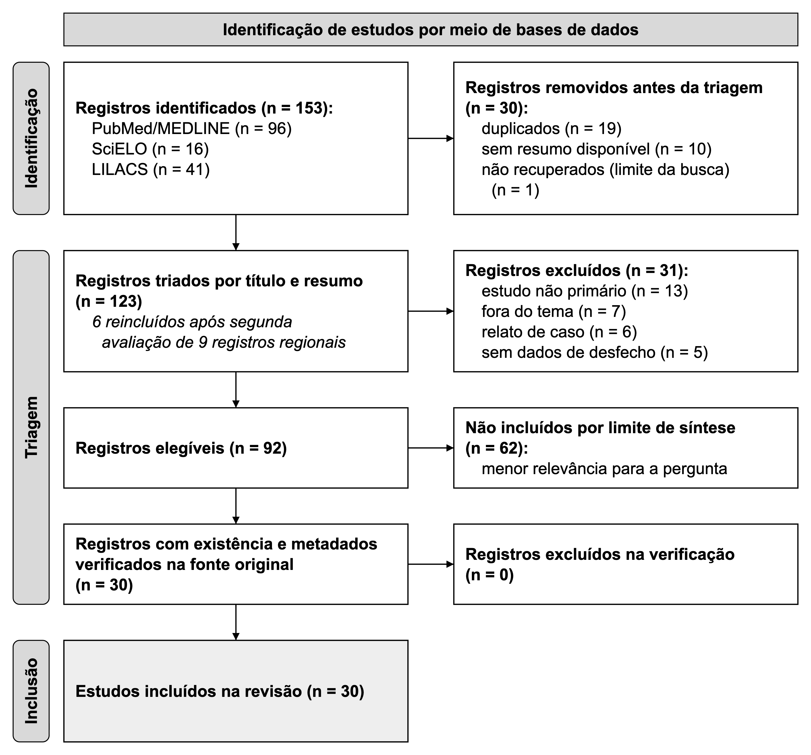

# Endometriose e Fertilidade: Repercussões na Integridade do Eixo Reprodutivo e Desfechos Clínicos: Revisão Integrativa

*Impacts of endometriosis on reproductive axis integrity and fertility outcomes: an integrative literature review*

*Repercusiones de la endometriosis en la integridad del eje reproductivo y los resultados de fertilidad: revisión integrativa de la literatura*

**RESUMO:** **Objetivo:** Analisar os impactos da endometriose na integridade do eixo reprodutivo e nos parâmetros de fertilidade em mulheres em idade fértil. **Métodos:** Revisão integrativa conduzida conforme o checklist PRISMA nas bases PubMed/MEDLINE, SciELO e LILACS (2021-2026). Incluíram-se estudos primários com mulheres em idade reprodutiva e diagnóstico confirmado da doença. A qualidade metodológica dos 30 estudos incluídos foi avaliada criticamente por instrumentos do Joanna Briggs Institute e ferramentas Cochrane de risco de viés. **Resultados:** Foram analisados 30 estudos. O comprometimento do eixo decorre da inflamação peritoneal crônica, distorção anatômica pélvica e estresse oxidativo intrafolicular acoplado a estresse bioenergético mitocondrial. Em desfechos laboratoriais substitutos, verificou-se declínio precoce da reserva folicular (hormônio antimülleriano e contagem de folículos antrais), intensificado por endometriomas e ressecções cirúrgicas prévias. Nos desfechos duros centrados na paciente, a doença determinou queda na qualidade oocitária, menores taxas de implantação embrionária e redução expressiva de nascidos vivos cumulativos em reprodução assistida. **Conclusão:** A endometriose compromete a fertilidade pela convergência de distorção anatômica, depleção folicular quantitativa e menor competência embrionária. O manejo exige preservação precoce da reserva ovariana e contenção de danos cirúrgicos iatrogênicos.

**Palavras-chave:** Endometriose; Infertilidade Feminina; Reserva Ovariana; Qualidade do Oócito; Receptividade Endometrial.

**ABSTRACT:** **Objective:** To analyze the impacts of endometriosis on female reproductive axis integrity and fertility parameters in women of reproductive age. **Methods:** Integrative review conducted according to the PRISMA checklist across PubMed/MEDLINE, SciELO, and LILACS databases (2021-2026). Primary studies involving reproductive-aged women with confirmed endometriosis were included. Methodological quality across the 30 included studies was critically appraised using Joanna Briggs Institute instruments and Cochrane risk-of-bias tools. **Results:** Thirty studies were analyzed. Reproductive axis impairment stems from chronic peritoneal inflammation, pelvic architectural distortion, and intrafollicular oxidative stress coupled with mitochondrial bioenergetic dysfunction. Regarding laboratory surrogate outcomes, premature ovarian reserve depletion was noted (anti-Müllerian hormone and antral follicle count), aggravated by endometriomas and prior surgical resections. In patient-centered hard outcomes, the disease induced lower oocyte competence, reduced implantation rates, and diminished cumulative live births in assisted reproduction. **Conclusion:** Endometriosis undermines fertility through the convergence of anatomical distortion, quantitative follicular depletion, and impaired embryo competence. Clinical management demands prompt fertility preservation and avoidance of iatrogenic surgical injury.

**Keywords:** Endometriosis; Female Infertility; Ovarian Reserve; Oocyte Quality; Endometrial Receptivity.

**RESUMEN:** **Objetivo:** Sintetizar la evidencia científica sobre las repercusiones de la endometriosis en la integridad del eje reproductivo femenino y los parámetros de fertilidad. **Métodos:** Revisión integrativa de la literatura realizada el 28 de septiembre de 2026 en las bases de datos PubMed/MEDLINE, SciELO y LILACS, que abarcó de 2021 a 2026 en portugués, inglés y español. Se identificaron 153 registros, se tamizaron 123 y se incluyeron 30 estudios de 13 países, incluidos diseños de cohortes, transversales, casos y controles y otros modelos metodológicos. **Resultados:** Los hallazgos indican una reducción sustancial de la hormona antimülleriana y del recuento de folículos antrales, principalmente en estadios III y IV y tras cistectomías ováricas laparoscópicas. En reproducción asistida, se evidenció un menor reclutamiento folicular y una recolección reducida de ovocitos en metafase II. El estrés oxidativo y las alteraciones transcriptómicas se asocian con una menor calidad ovocitaria y mayor aneuploidía embrionaria, mientras que las tasas de fertilización y recién nacidos vivos varían según los protocolos de estimulación y la extensión lesional. **Conclusión:** La endometriosis afecta la fertilidad femenina mediante la depleción de la reserva ovárica, alteraciones en la foliculogénesis y deterioro de la competencia ovocitaria, con repercusiones moduladas por el estadio patológico y los antecedentes terapéuticos quirúrgicos.

**Palabras clave:** Endometriosis; Reserva ovárica; Infertilidad femenina; Técnicas de reproducción asistida; Hormona antimülleriana.

## 1 Introdução

### Magnitude Epidemiológica e Carga Reprodutiva

A endometriose afeta aproximadamente 10% das mulheres em idade fértil, taxa que escala para cerca de 40% a 50% entre pacientes submetidas à elucidação etiológica de infertilidade [9,11]. A síndrome dolorosa característica — dominada por dismenorreia incapacitante, dispareunia de profundidade e dor pélvica crônica acíclica [9,11,12] — coexiste com taxas desproporcionais de falha reprodutiva, elevando em mais de seis vezes o risco relativo de infertilidade quando confrontada a populações controle [4]. Essa sobrecarga é agravada pelo retardo diagnóstico de anos e pela carência de estratégias estruturadas de aconselhamento reprodutivo na atenção básica e especializada, privando as pacientes do planejamento temporal oportuno para concepção natural ou preservação da fertilidade [10,13]. No parênquima gonadal, o desenvolvimento de endometriomas induz estiramento mecânico, reação desmoplásica capsular e compressão vascular do estroma cortical adjacente [9,15], precipitando a depleção prematura do reservatório de folículos primordiais.

### Eixos Mecanísticos: Inflamação, Citotoxicidade e Distorção Funcional

A fisiopatologia da disfunção reprodutiva na endometriose não se restringe à distorção anatômica pélvica e às aderências fibrosas que bloqueiam a captação e o trânsito tubário. Em nível microambiental, instala-se um estado inflamatório estéril contínuo. Fluidos peritoneais de mulheres afetadas concentram títulos expressivos de citocinas pró-inflamatórias, com destaque para a ativação do eixo interleucina-23 (IL-23), interleucina-17 (IL-17) e fator de necrose tumoral alfa (TNF-α) [20]. Essa tempestade de mediadores inflamatórios atinge o fluido folicular, retroalimentando o estresse oxidativo intrafolicular [5,20]. Paralelamente, perturbações autoimunes, evidenciadas pela elevada prevalência de autoanticorpos concomitantes [3], coexistem com a degradação da homeostase oocitária.

A nível subcelular, o estresse oxidativo sustentado altera o maquinário de transdução de sinal e a atividade translacional global dos oócitos, modificando redes de *splicing* e o alinhamento meiótico cromossômico [22]. Em modelos funcionais, a exposição embrionária inicial a esse ambiente peritoneal tóxico inibe o desenvolvimento e a taxa de eclosão de blastocistos, dano atenuável por antioxidantes como a N-acetilcisteína [5]. Isso demonstra que a citotoxicidade microambiental compromete tanto a maturação gamética quanto o potencial morfogenético inicial do concepto, elevando as taxas de aneuploidia sem necessariamente impedir a fecundação primária [27].

### O Estado da Arte e o Dissenso entre Marcadores Substitutos e Desfechos Centrados na Paciente

Embora a literatura seja unânime quanto à redução de marcadores laboratoriais de reserva ovariana — refletida em quedas expressivas do hormônio antimülleriano (AMH) e da contagem de folículos antrais, particularmente na doença moderada a avançada e nos endometriomas [15,16] —, persiste um descompasso metodológico entre esses desfechos substitutos e os desfechos duros centrados na paciente. Coortes observacionais demonstram que a diminuição na contagem de oócitos captados e o rebaixamento de AMH em ciclos estimulados não determinam, obrigatoriamente, redução equiparável na taxa cumulativa de nascidos vivos [1,19,25]. A preservação embrionária parece sustentar desfechos gestacionais viáveis em subgrupos específicos, mesmo perante menor resgate ovocitário [1,2,19].

Contudo, essa aparente resiliência não é uniforme. Séries dedicadas à endometriose peritoneal profunda e ao acometimento ovariano volumoso indicam quedas reais na taxa de gravidez clínica por transferência e nascidos vivos [21,26,28,30]. Esse cenário diverge conforme a faixa etária da paciente [21] ou o manejo terapêutico empregado, haja vista que a cistectomia excisional frequentemente impõe dano iatrogênico adicional à reserva gonadal em comparação a técnicas conservadoras como a escleroterapia [19,23,24]. Ademais, a ausência de consenso sobre o real impacto da endometriose mínima e leve (estágios I/II da ASRM) sobre a fecundabilidade natural e assistida perpetua divergências clínicas, ora imputando à doença subclínica falhas de implantação inexplicadas, ora considerando o fenótipo superficial um achado incidental desprovido de impacto prognóstico [2,7].

### Lacuna Epistêmica, Justificativa Clínica e Objetivo

A persistência dessas controvérsias decorre de limitações metodológicas frequentes nos estudos disponíveis: heterogeneidade amostral pronunciada, inclusão indistinta de fenótipos estadiados cirurgicamente e não cirurgicamente, ausência de pareamento por idade materna e tempo de infertilidade, e a comum indistinção entre o insulto parenquimatoso intrínseco da doença e a agressão térmica ou excisional decorrente de intervenções cirúrgicas prévias [17,21,24,26,28,30]. Permanece uma lacuna epistêmica crítica quanto a uma síntese integrativa que conecte, sob critério metodológico estrito, as alterações celulares e microambientais aos desfechos reprodutivos duros, superando o foco restrito em biomarcadores isolados de resposta ovariana. Essa integração justifica-se clinicamente pela urgência em balizar condutas terapêuticas personalizadas, distinguir quando intervir cirurgicamente sem incorrer em falência gonadal iatrogênica e estruturar o aconselhamento reprodutivo seguro de casais inférteis.

Com base nesse panorama e em conformidade com o item 4 da declaração PRISMA 2020, o objetivo desta revisão integrativa é analisar criticamente as evidências científicas sobre como a endometriose afeta a integridade do eixo reprodutivo feminino e os parâmetros de fertilidade em mulheres em idade fértil, discriminando seu impacto sobre a reserva ovariana funcional, a competência ovocitária e embrionária e as taxas cumulativas de gravidez e nascidos vivos.

## 2 Métodos

### 2.1 Tipo de estudo e formulação da questão norteadora

Trata-se de uma revisão integrativa da literatura estruturada segundo o referencial metodológico de Mendes, Silveira e Galvão e de Whittemore e Knafl, complementada pelos preceitos de transparência e reprodutibilidade da declaração PRISMA 2020. A definição da pergunta norteadora baseou-se no acrônimo PICOS:
- População (P): mulheres em idade reprodutiva;
- Exposição/Intervenção (I): diagnóstico de endometriose pélvica ou endometrioma ovariano;
- Comparador (C): mulheres sem endometriose, controles pareados hígidos, outras causas de infertilidade ou intervenções terapêuticas comparativas;
- Desfechos (*Outcomes* - O): alterações em biomarcadores da reserva ovariana, competência ovocitária e embrionária, receptividade endometrial e desfechos reprodutivos clínicos (taxa de gravidez clínica e taxa cumulativa de nascidos vivos);
- Delineamento de estudo (*Study design* - S): estudos primários observacionais analíticos e ensaios clínicos controlados.

A partir dessa delimitação, formulou-se a seguinte questão condutora: de que maneira a endometriose afeta a integridade do eixo reprodutivo feminino e os parâmetros de fertilidade em mulheres em idade fértil?

### 2.2 Bases de dados e cronograma de busca

A busca bibliográfica foi conduzida nas bases PubMed/MEDLINE, SciELO e LILACS. O PubMed/MEDLINE foi consultado por meio da interface de programação oficial E-utilities do National Center for Biotechnology Information (NCBI); o SciELO, via portal integrado da rede (search.scielo.org); e o LILACS, pelo Portal Regional da Biblioteca Virtual em Saúde (pesquisa.bvsalud.org). A busca final foi executada em 28 de setembro de 2026. A explicitação da data vincula-se ao dinamismo do fluxo de indexação das bases, no qual novas catalogações podem alterar o quantitativo recuperado a partir de sintaxes idênticas.

### 2.3 Descritores e estratégias de busca

Empregaram-se descritores controlados do Medical Subject Headings (MeSH) — "Endometriosis", "Infertility, Female", "Ovarian Reserve" — e dos Descritores em Ciências da Saúde (DeCS) — "Endometriose", "Infertilidade Feminina", "Reserva Ovariana", "Endométrio" —, associados a termos livres e sinônimos operados pelos conectores booleanos AND e OR. O Quadro 1 reúne as sintaxes aplicadas, os filtros específicos e os volumes de recuperação documental em cada fonte.

**Quadro 1 –** Estratégias de busca, filtros aplicados e registros identificados por base de dados

| Base | Estratégia de busca | Filtros aplicados | Registros (n) |
| --- | --- | --- | --- |
| PubMed/MEDLINE | (("Endometriosis"[MeSH Terms] OR "endometrioma"[tiab]) AND ("Ovarian Reserve"[MeSH Terms] OR "ovarian reserve"[tiab] OR "oocyte quality"[tiab] OR "endometrial receptivity"[tiab] OR "reproductive axis"[tiab]) AND ("Infertility, Female"[MeSH Terms] OR "infertility"[tiab] OR "fecundity"[tiab])) AND ("2021/01/01"[dp]: "3000"[dp]) AND (portuguese[la] OR english[la] OR spanish[la]) AND "free full text"[Filter] NOT (review[pt] OR "systematic review"[pt] OR "meta-analysis"[pt] OR editorial[pt] OR letter[pt] OR comment[pt] OR "practice guideline"[pt] OR "case reports"[pt]) | • Período: 2021 a 2026 • Idiomas: pt, en, es • Texto: completo gratuito • Exclusão: revisões e relatos de caso (na sintaxe) | 96 |
| SciELO | ("endometriose" OR "endometriosis" OR "endometrioma") AND ("fertilidade" OR "infertilidade feminina" OR "reserva ovariana" OR "fertility" OR "female infertility" OR "ovarian reserve" OR "fertilidad" OR "infertilidad femenina" OR "reserva ovárica") | • Período: 2021 a 2026 • Idiomas: pt, en, es • Texto: acesso aberto • Exclusão: revisões e relatos de caso (na triagem) | 16 |
| LILACS | ("endometriose" OR "endometriosis" OR "endometrioma") AND

## 3 Resultados

### 3.1 Seleção dos estudos e fluxo PRISMA

A recuperação inicial nas bases de dados eletrônicas identificou 153 registros primários (PubMed/MEDLINE: 96; SciELO: 16; LILACS: 41). Desses, 1 registro com baixa correspondência algorítmica não foi recuperado para triagem. Após a eliminação de duplicatas (19), exclusão de artigos sem resumo disponível (10) e de registros não recuperados pelo filtro de busca (1), 123 publicações avançaram para a etapa de triagem de títulos e resumos. A aplicação dos critérios de inclusão e exclusão culminou na remoção de 31 artigos pelos seguintes motivos: delineamento não primário (13), escopo temático não aderente (7), relatos de caso isolados (6) e ausência de dados de desfecho reprodutivo (5). A reavaliação metodológica de 9 registros regionais anteriormente apartados permitiu a reintegração de 6 estudos ao processo analítico. Subsequentemente, 92 artigos foram submetidos à leitura na íntegra, dos quais 62 foram descartados por critérios de viabilidade e alinhamento temático estrito. Ao final, 30 estudos primários cumpriram a totalidade dos critérios de elegibilidade e integraram o corpus analítico (Figura 1).

**Figura 1 –** Fluxograma de identificação, triagem e inclusão dos estudos, estruturado segundo as diretrizes PRISMA

Fonte: Elaborado pelos autores a partir do protocolo PRISMA.

### 3.2 Caracterização dos estudos incluídos

A Tabela 1 sintetiza as características dos 30 estudos analisados, contemplando autoria, ano, país de origem, delineamento metodológico, população, estadiamento da doença, intervenções ou exposições avaliadas, desfechos quantificados, qualidade metodológica e achados centrais.

**Tabela 1 –** Caracterização dos estudos incluídos segundo variáveis clínicas, operacionais e metodológicas

| Autor/Ano | País | Delineamento e População | Estágio da Endometriose | Intervenção / Exposição | Desfechos Avaliados | Qualidade Metodológica | Principais Achados |
| :--- | :--- | :--- | :--- | :--- | :--- | :--- | :--- |
| Feng et al., 2026 [19] | China | Coorte retrospectiva; 394 pacientes inférteis em primeiro ciclo de FIV | Endometrioma ovariano | Cistectomia laparoscópica em cistos ≥4 cm vs. conduta não cirúrgica (<4 cm e ≥4 cm) | AMH sérico, oócitos recuperados, parâmetros embriológicos e taxa cumulativa de nascidos vivos | Newcastle-Ottawa: 8/9 | A cistectomia reduziu o AMH e o número de oócitos coletados, sem modificar a taxa cumulativa de nascidos vivos entre os grupos. |
| Griffiths et al., 2026 [20] | Reino Unido | Transversal analítico; 105 amostras de sangue e 38 de fluido peritoneal | Peritoneal superficial (SPE) e ovariana (OE) | SPE isolada (n=43), SPE associada a OE (n=23) vs. controles saudáveis (n=39) | AMH sérico e citocinas inflamatórias peritoneais (IL-17, TNF-α, IL-23) | Newcastle-Ottawa: 7/9 | Concentrações séricas de AMH foram menores em SPE e SPE+OE; SPE associou-se a títulos elevados de IL-17, TNF-α e IL-23 no peritônio. |
| Park et al., 2026 [18] | Coreia do Sul | Coorte retrospectiva; 92 ciclos de ICSI com 1 a 5 oócitos MII | Endometrioma ovariano | Endometrioma ovariano (34 ciclos), infertilidade sem causa aparente (26 ciclos) e baixa reserva ovariana (32 ciclos) | Índice médio de qualidade oocitária (AOQI) e AMH sérico | Newcastle-Ottawa: 7/9 | O AOQI foi de 1,50 no grupo endometrioma, 1,00 na infertilidade inexplicada e 1,42 na baixa reserva; o AMH correlacionou-se inversamente ao AOQI. |
| Valenti et al., 2026 [15] | Estados Unidos | Coorte retrospectiva; 348 mulheres (18–44 anos) do estudo ENDO | Estágios I a IV (ASRM); superficial, profunda e ovariana | Diagnóstico cirúrgico de endometriose e seus subtipos anatômicos | AMH sérico pré-operatório | Newcastle-Ottawa: 8/9 | Redução de 40,

## 4 Discussão

### 4.1 Síntese e interpretação analítica dos achados à luz do eixo reprodutivo

Esta revisão investigou de que maneira a endometriose afeta a integridade do eixo reprodutivo feminino e os parâmetros de fertilidade em mulheres em idade fértil. A análise integrada dos 30 estudos primários demonstra que o impacto da doença opera em múltiplos níveis do trato genital: esgota prematuramente o pool folicular, perturba a fisiologia oocitária e reduz o rendimento em ciclos estimulados. Contudo, essa agressão biológica não suprime de forma uniforme os desfechos gestacionais quando embriões euploides atingem a cavidade uterina.

No parênquima ovariano, os estágios moderados e avançados (III e IV) provocam queda substancial dos biomarcadores de reserva folicular, designadamente o hormônio antimülleriano (HAM) e a contagem de folículos antrais (CFA) [1,15,16,28]. Em coorte prospectiva mexicana com 178 participantes, mulheres portadoras de doença avançada apresentaram HAM médio de 1,6 ± 1,3 ng/mL contra 2,5 ± 1,4 ng/mL no grupo controle (p < 0,005), além de retração na CFA de 11,4 ± 8,3 versus 17,5 ± 10,3 (p < 0,001) [1]. Na mesma linha, investigação transversal brasileira identificou mediana de HAM de 0,66 ng/mL entre portadoras soropositivas para autoanticorpos antitireoidianos frente a 1,37 ng/mL nas soronegativas (p = 0,09) [3]. Esse paralelismo aponta para uma depleção folicular acelerada quando focos ectópicos coexistem com desregulação autoimune sistêmica [3].

A perda da densidade folicular impõe entraves diretos aos procedimentos de fertilização in vitro. Em coorte com 3.517 pacientes, a prevalência de reserva ovariana diminuída (HAM < 1,1 ng/mL) alcançou 26,23% nas mulheres submetidas à cistectomia prévia, proporção significativamente superior à observada sob conduta não cirúrgica (12,90%) e nos controles sem afecção gonadal (13,56%) [23]. Essa restrição quantitativa repercute na punção: dados clínicos confirmam menor recrutamento folicular total (16,2 ± 8,8 versus 23,1 ± 9,7; p < 0,001) e aspiração ovocitária deprimida (7,3 ± 5,1 versus 10,4 ± 4,6; p < 0,001) no estadiamento III-IV [1]. Trata-se de um afunilamento laboratorial objetivo, no qual a escassez de gametas limita o número de blastocistos formados.

Para além do inventário numérico de oócitos, a afecção compromete a competência intrínseca dos gametas. O ensaio biológico de Giorgi et al. demonstrou que a incubação de embriões murinos em fluido folicular de pacientes com doença incipiente reduziu a taxa de eclosão de blastocistos para 12,5%, em contraste com 42,1% no grupo controle (p = 0,029); a adição do antioxidante N-acetil-cisteína reverteu esse bloqueio para 44,4% (p = 0,02) [5]. O resultado comprova que espécies reativas de oxigênio e subprodutos de lipoperoxidação intrafoliculares desorganizam a clivagem celular precoce [5]. Em nível molecular, o sequenciamento transcriptômico unicelular confirma que o endometrioma distorce a maquinaria de tradução nos oócitos, afetando checkpoints meióticos e complexos de processamento de RNA mensageiro [22]. Essa lesão ultraestrutural traduz-se morfologicamente na rotina clínica: em 92 ciclos de injeção intracitoplasmática, o índice de desbalanço morfológico ovocitário (AOQI) atingiu 1,50 nas portadoras de endometrioma, patamar superior a 1,00 registrado na infertilidade sem causa aparente (p = 0,037), equiparável ao dano por reserva diminuída per se (1,42) e inversamente correlacionado às concentrações de HAM (r = -0,242; p = 0,02) [18].

A interpretação clínica exige distinguir desfechos substitutos de desfechos duros centrados no nascimento de recém-nascidos vivos a termo. Marcadores laboratoriais intermediários (concentrações séricas de HAM, número de folículos antrais e oócitos metafase II recuperados) sofrem quedas reproduzíveis; em contrapartida, taxas de implantação, gestação clínica e nascidos vivos mostram resiliência quando embriões cromossomicamente normais são transferidos. Em coorte francesa, a taxa de gravidez em curso permaneceu comparável à de controles na análise global da endometriose, declinando apenas na taxa cumulativa por casal nos subgrupos com infiltração profunda (p < 0,05) [28]. Sob perspectiva genética, a análise de 625 ciclos revelou que, a despeito de taxas maiores de aneuploidia em embriões de mulheres com endometriose (p = 0,012), as taxas de implantação e de nascidos vivos foram equivalentes após o rastreamento genético pré-implantacional [27]. Constata-se que a barreira reprodutiva na endometriose reside prioritariamente no rendimento folicular e na integridade do oócito, e não em uma falha primária da receptividade endometrial à nidação.

### 4.2 Confronto dialético e mecanismos biológicos da afecção

A literatura diverge substancialmente quando confronta casuísticas cirúrgicas e laboratoriais. De um lado, estudos clínicos em centros terciários descrevem declínio acentuado nas taxas de gravidez clínica entre portadoras de endometriomas volumosos ou submetidas a cirurgias excisionais agressivas em relação a controles com fator tubário isolado [21,26,29,30]. De outro lado, séries de reprodução assistida demonstram equivalência nas taxas de fertilização, qualidade morfológica de clivagem embrionária e nascidos vivos, particularmente nos quadros peritoneais superficiais [2,25]. Essa aparente discordância resulta de heterogeneidades metodológicas e amostrais: enquanto coortes desfavoráveis concentram fenótipos invasivos com perda mecânica de tecido ovariano [21,23,26], estudos que encontram neutralidade analisam pacientes jovens com reserva gonadal residual preservada ou quadros leves submetidos precocemente à fertilização in vitro [2,25].

Nesse contexto patológico, as lesões peritoneais superficiais não atuam de forma inócua. Pacientes com implantes superficiais isolados apresentam declínio de HAM comparadas a controles sadios (p = 0,009), fenômeno acompanhado por concentrações elevadas de IL-17, TNF-α e IL-23 no lavado peritoneal [20]. Esse dado rebate o pressuposto mecanicista de que a perda folicular dependeria da expansão cística ovariana. A cascata inflamatória pélvica atinge o córtex gonadal por contiguidade tecidual e estresse oxidativo microvascular [20]. Todavia, a quantificação desse estado pró-inflamatório esbarra em discrepâncias laboratoriais: ensaios de proteína C-reativa divergem entre métodos ultrassensíveis que marcam limiares patológicos em 8,2 mg/L e técnicas convencionais com pontos de corte em 100 mg/L (expressos como 10 mg/dL, pela conversão de 1 mg/dL = 10 mg/L). Essa variação analítica impede comparações uniformes da resposta inflamatória sistêmica entre diferentes coortes.

Vieses socioeconômicos e demoras no encaminhamento clínico acentuam as discrepâncias dos desfechos. Em séries latino-americanas marcadas por anos de atraso diagnóstico, a doença atinge estágios avançados com extensa destruição pélvica e aderências densas. Em casuística venezuelana, 97,83% das pacientes diagnosticadas apresentavam queixa primária de infertilidade, perfazendo razão de risco de 6,65 para esse desfecho [4]. Em paralelo, coorte brasileira com 227 pacientes registrou infertilidade em 43,8% da amostra, acompanhada por taxas severas de dismenorreia (84,7%) e dor pélvica crônica limitante [11]. Esses índices sobrecarregados contrastam com casuísticas da Europa setentrional, nas quais a intervenção em fases incipientes mitiga distorções anatômicas tubárias e fibroses ovarianas irreversíveis.

No campo das estratégias terapêuticas, o confronto entre abordagens cirúrgicas e protocolos de estimulação farmacológica revela trajetórias antagônicas. Em portadoras de endometriose com baixa reserva, o protocolo ultralongo com agonista de GnRH atingiu taxa cumulativa de nascidos vivos de 48,5%, superando o protocolo longo tradicional (OR: 0,577; p = 0,042), o protocolo curto (OR: 0,608; p = 0,028) e os esquemas com antagonista (OR: 0,486; p = 0,004) [17]. A dessensibilização hipofisária contínua atenua a tempestade de citocinas inflamatórias pélvicas e favorece a esteroidogênese [17]. Em contrapartida, frente a endometriomas volumosos (≥4 cm), a escleroterapia com etanol alcançou taxa cumulativa de nascidos vivos de 65%, superando tanto a cistectomia laparoscópica (29%) quanto a conduta expectante (30,8%) [24]. A cistectomia excisional inadvertida extirpa tecido cortical sadio adjacente à pseudocápsula ovariana e gera isquemia focal secundária à eletrocoagulação hemostática bipolar, sacrificando folículos primordiais em troca de benefício histológico meramente aparente [19,23,24].

### 4.3 Limitações metodológicas dos estudos incluídos e da revisão integrativa

Os estudos primários analisados exibem limitações metodológicas estruturais. Predominam delineamentos observacionais retrospectivos e transversais unicêntricos, suscetíveis a viés de seleção e atrito amostral. Pacientes sintomáticas, com histórico de dor intratável e falhas recorrentes de concepção, concentram-se em hospitais terciários e são sobrerrepresentadas nas casuísticas. Na esfera operatória, inexiste padronização sistemática sobre os métodos de hemostasia ovariana (ablação por radiofrequência, eletrocoagulação bipolar ou sutura hemostática), inviabilizando a quantificação exata da injúria térmica iatrogênica sobre a reserva folicular. No ambiente laboratorial, a divergência entre plataformas de quimioluminescência para dosagem de HAM e kits de citocinas compromete a comparabilidade interensaio. Quanto à presente revisão integrativa, a acentuada heterogeneidade de intervenções, populações e critérios de estadiamento impediu a síntese quantitativa por metanálise e metarregressão, restringindo o escopo analítico à consolidação qualitativa crítica dos dados.

### 4.4 Implicações clínicas e lacunas para investigações futuras

A prática clínica exige separar rigorosamente a queda de biomarcadores laboratoriais da real probabilidade de gravidez. Reduções de HAM ou da contagem de folículos antrais não autorizam intervenções cirúrgicas de ressecção gonadal como pré-requisito para tratamentos reprodutivos. Condutas conservadoras, fundamentadas na preservação prévia da fertilidade por vitrificação de oócitos e na supressão medicamentosa do microambiente inflamatório pélvico, oferecem maior segurança antes da transferência embrionária. Diante de endometriomas que exigem descompressão por quadro doloroso refratário, métodos poupadores de parênquima, a exemplo da escleroterapia ecoguiada ou da ablação a laser, minimizam o comprometimento folicular residual.

Em prazo estendido, a depleção acelerada do patrimônio folicular antecipa o climatério e encurta a janela reprodutiva, gerando repercussões cardiovasculares e ósseas associadas ao hipoestrogenismo precoce. No horizonte investigativo, são necessários ensaios clínicos randomizados multicêntricos comparando a escleroterapia de endometriomas, o manejo expectante e a reprodução assistida primária, adotando a taxa cumulativa de nascidos vivos por intenção de tratar e a sobrevida longitudinal da reserva gonadal como desfechos primários mandatórios.

## 5 Conclusão

A endometriose compromete a integridade do eixo reprodutivo feminino por meio de uma cascata multifatorial que integra distorção anatômica pélvica, estresse oxidativo intrafolicular e microambiente peritoneal hiperinflamatório. Essa sinergia patológica acelera a depleção da reserva ovariana — evidenciada pela redução sustentada do hormônio antimülleriano e da contagem de folículos antrais — e induz estresse bioenergético mitocondrial nos oócitos. Consequentemente, observam-se prejuízos diretos em desfechos clínicos centrados na paciente, incluindo queda nas taxas de fertilização, pior cinética embrionária, falhas de implantação e redução de nascidos vivos cumulativos em ciclos de reprodução assistida.

A magnitude dessas repercussões varia substancialmente conforme o fenótipo da lesão, a bilateralidade dos endometriomas e o histórico de intervenções cirúrgicas excisionais, que frequentemente impõem dano iatrogênico adicional ao estroma gonadal viável. Na prática clínica, tais achados demandam conduta vigilante e personalizada: o aconselhamento reprodutivo em tempo oportuno e a indicação precoce de criopreservação oocitária devem prevalecer sobre cirurgias ovarianas repetitivas e desnecessárias. Para avanços futuros, faz-se imperativa a condução de ensaios clínicos prospectivos e randomizados que comparem abordagens cirúrgicas conservadoras ao acesso primário às tecnologias de reprodução assistida, consolidando condutas pautadas em taxas de nascidos vivos a termo.

## Referências

1. Molina Rodríguez R. Epidemiologia, clínica y evolución en pacientes con endometriosis. Rev Obstet Ginecol Venez. 2024;84(3):299-306. doi:10.51288/00840311.
2. Pontes CFR, Chamié LP, Aguiar MM, Silva EJC, Leite DFB, Silva SALC, et al. Endometriose profunda: achados clínicos e epidemiológicos de mulheres diagnosticadas segundo critérios do International Deep Endometriosis Analysis Group (IDEA). Rev Bras Crescimento Desenvolv Hum. 2022;32(2):223-231. doi:10.36311/jhgd.v32.13312.
3. Bonachea-Peña RR, Rodríguez-Arozarena C, González-Coca DB, Rodríguez-Chamizo C, Bonachea-Rodríguez M. Dolor pélvico crónico en mujeres. Arch Med Camaguey. 2021;25(4). Disponível em: http://scielo.sld.cu/scielo.php?script=sci_arttext&pid=S1025-02552021000400006 [citado 2026 set 28]
4. Cardozo-Henríquez V, Ávila-Berardi F, Cardozo-Belisario L, Rodríguez-Roque S. Endometriosis como causa de infertilidad. Rev Obstet Ginecol Venez. 2025;85(1):52-58. Disponível em: http://www.scielo.org.ve/scielo.php?script=sci_arttext&pid=S0048-77322025000100052 [citado 2026 set 28]
5. Pereira JO, Kulak Junior J. Exploring endometriosis before surgical treatment: unraveling pain, sexual function and quality of life patterns. Rev Bras Ginecol Obstet. 2025;47. doi:10.61622/rbgo/2025rbgo47.
6. Nogueira Neto J, Melo VG, Lima LCS, Mendes ABC, Barreto FN, Gomes LMRS, et al. The impact of videolaparoscopic surgery in the treatment of endometriosis on depression levels. Rev Assoc Med Bras (1992). 2024;70(7). doi:10.1590/1806-9282.20231651.
7. Sousa TL, Silva RM, Ribeiro LB, Pontes SS. O conhecimento de mulheres portadora de endometriose sobre a doença e o planejamento familiar. REVISA (Online). 2021;10(2):379-387. Disponível em: https://pesquisa.bvsalud.org/portal/resource/pt/biblio-1253819 [citado 2026 set 28]
8. Giorgi VSI, Ferriani RA, Navarro PA. Fluido folicular de mulheres inférteis com endometriose leve prejudica o desenvolvimento in vitro de embriões bovinos: Potencial papel do estresse oxidativo. Rev Bras Ginecol Obstet. 2021;43(2):119-125. doi:10.1055/s-0040-1718443.
9. Akay A, Dilbaz B, Engin-Üstün Y. Comparison of serum markers of inflammation in endometrioma and benign ovarian cysts. Rev Bras Ginecol Obstet. 2025;47. doi:10.61622/rbgo/2025rbgo58.
10. Griffiths MJ, Brown ME, Gibson DA, Collins F, Dunlop CE, Saunders PTK, et al. Anti-Müllerian hormone decreased in women with superficial peritoneal endometriosis and associated with an elevated inflammatory profile. Reprod Fertil. 2026;7(2):RAF250127. doi:10.1530/RAF-25-0127. PMID: 42160260.
11. Diao X, Huang J, Xiang R, Zhuang S, Liang Q, Liang X, et al. Single-cell dual-omics reveals translational and transcriptional landscapes and regulations in oocytes from ovarian endometriosis patients. Front Endocrinol (Lausanne). 2025;16:1534648. doi:10.3389/fendo.2025.1534648. PMID: 40034233.
12. Bianco B, Loureiro FA, Trevisan CM, Christofolini DM, Laganà AS, Barbosa CP. Implication of FSHB rs10835638 variant in endometriosis in Brazilian women. Einstein (Sao Paulo). 2023;21. doi:10.31744/einstein_journal/2023ao0483.
13. Souza ASR, Ferreira MER, Gomes RC, Rios SV, Chacon VO, Viana MAB, et al. Endometriosis, autoimmunity and ovarian reserve: a research note. Rev Bras Saude Mater Infant. 2025;25. doi:10.1590/1806-9304202520240276-en.
14. Sorvia Naveda KD, Barros Delgadillo JC, Espino y Sosa S. Efecto de la endometriosis etapa III-IV en ciclos de reproducción asistida: FIV e ICSI. Ginecol Obstet Mex. 2024;92(12):501-509. Disponível em: https://www.scielo.org.mx/scielo.php?script=sci_arttext&pid=S0300-90412024001200501 [citado 2026 set 28]
15. Valenti M, Schliep KC, Paulsen M, Hemmert RB, Peterson CM, Furlong MA, et al. Incident endometriosis diagnosis and AMH: how surgical staging and typology relate to serum AMH levels. Am J Obstet Gynecol. 2026;234(5):1450-1458. doi:10.1016/j.ajog.2025.12.070. PMID: 41519422.
16. Farland LV, Valenti M, Degnan WJ, Bertone-Johnson ER, Harris HR, DiVasta AD, et al. Laparoscopically confirmed endometriosis and anti-Müllerian hormone levels: Findings from the Nurses' Health Study II. Maturitas. 2024;183:107969. doi:10.1016/j.maturitas.2024.107969. PMID: 38489917.
17. Lu R, Jiao W, Li X, Zeng C, Shang J, Xue Q. Ovarian endometriosis negatively impacts pregnancy outcomes in young infertile women undergoing IVF/ICSI treatment. Eur J Med Res. 2025;30(1):555. doi:10.1186/s40001-025-02816-9. PMID: 40604864.
18. Zhang F, Chen Y, Lv C, Ni F, Yan L, Song J. A retrospective cohort study comparing controlled ovarian stimulation protocols for IVF/ICSI in women with endometriosis and diminished ovarian reserve. Front Endocrinol (Lausanne). 2026;17:1879193. doi:10.3389/fendo.2026.1879193. PMID: 42666230.
19. Haque A, Primariawan RJ, Hendarto H. Comparison of success rates in early stages of in vitro fertilization (IVF) in women with and without endometriosis. Narra J. 2024;4(3):e1019. doi:10.52225/narra.v4i3.1019. PMID: 39816123.
20. Qu H, Lv H, Kang Y, Yan L, Du Y. Reproductive outcomes of single frozen-thawed embryo transfer in patients with endometriosis after preimplantation genetic testing. J Assist Reprod Genet. 2024;41(2):429-435. doi:10.1007/s10815-023-02996-5. PMID: 38079077.
21. Park JH, Kim SK, Jee BC. Average oocyte quality index as a method for scoring dysmorphic oocytes in women with ovarian endometrioma undergoing in vitro fertilization and its correlation with ovarian reserve. Clin Exp Reprod Med. 2026;53(3):219-225. doi:10.5653/cerm.2025.08438. PMID: 41560389.
22. Caran J, Genro VK, Souza CAB, Cunha-Filho JS. Escore embrionário graduado em embriões de mulheres inférteis com e sem endometriose peritoneal. Rev Bras Ginecol Obstet. 2021;43(1):28-34. doi:10.1055/s-0040-1721855.
23. Morcel K, Merviel P, Bouée S, Le Guillou M, Carlier M, James P, et al. What is the impact of endometriosis and the AFS stage on cumulative pregnancy rates in IVF programs? Reprod Health. 2024;21(1):13. doi:10.1186/s12978-024-01747-8. PMID: 38287446.
24. Sánchez-Resendis Ó, Ávila-Morales J, Sánchez-Aguilar ÓE, Del Valle-Jiménez JH. Long-term management of pelvic pain with levonorgestrel in women with endometriosis who desire to postpone a future pregnancy and preserve their fertility. Case Series. Ginecol Obstet Mex. 2023;91(5):307-316. Disponível em: https://pesquisa.bvsalud.org/portal/resource/pt/biblio-1506265 [citado 2026 set 28]
25. Feng Y, Yang X, Chen H, Zhang L, Cui C, Wang L, et al. Direct IVF versus prior laparoscopic cystectomy for ovarian endometrioma ≥4 cm: cumulative live birth rate and implications for fertility preservation - a retrospective cohort study. Front Endocrinol (Lausanne). 2026;17:1851907. doi:10.3389/fendo.2026.1851907. PMID: 42601902.
26. Li Y, Gong Y, Jiang H, Ji M. Impact of endometriotic cystectomy on ovarian reserve function and ovulation induction outcomes in women with endometriosis undergoing assisted reproductive technology. Front Endocrinol (Lausanne). 2025;16:1687765. doi:10.3389/fendo.2025.1687765. PMID: 41635542.
27. Şükür YE, Kaplan NB, Aslan B, Akgün N, Özmen B, Sönmezer M, et al. Optimal management of large endometriomas (≥ 4 cm) before IVF: ethanol sclerotherapy, cystectomy, or no intervention? BMC Womens Health. 2025;25(1):507. doi:10.1186/s12905-025-04069-4. PMID: 41121030.
28. Hernández A, Sanz A, Spagnolo E, Lopez A, Martínez Jorge P, Iniesta S, et al. Impact of Ovarian Endometrioma and Surgery on Reproductive Outcomes: A Single-Center Spanish Cohort Study. Biomedicines. 2023;11(3):844. doi:10.3390/biomedicines11030844. PMID: 36979823.
29. Nadă ES, Coroleucă CB, Coroleucă CA, Brătilă E. Ovarian Stimulation for In Vitro Fertilization and Reproductive Outcome after Surgical Treatment of Endometriosis Compared with Tubal Factor Infertility. Clin Pract. 2023;14(1):1-12. doi:10.3390/clinpract14010001. PMID: 38391397.
30. Nadă ES, Coroleucă CA, Coroleucă CB, Brătilă E. Reproductive outcome after in vitro fertilization in endometriosis - key factors and implications. J Med Life. 2024;17(3):334-340. doi:10.25122/jml-2024-0114. PMID: 39044926.
31. Page MJ, McKenzie JE, Bossuyt PM, Boutron I, Hoffmann TC, Mulrow CD, et al. The PRISMA 2020 statement: an updated guideline for reporting systematic reviews. BMJ. 2021;372:n71. doi:10.1136/bmj.n71. PMID: 33782057.